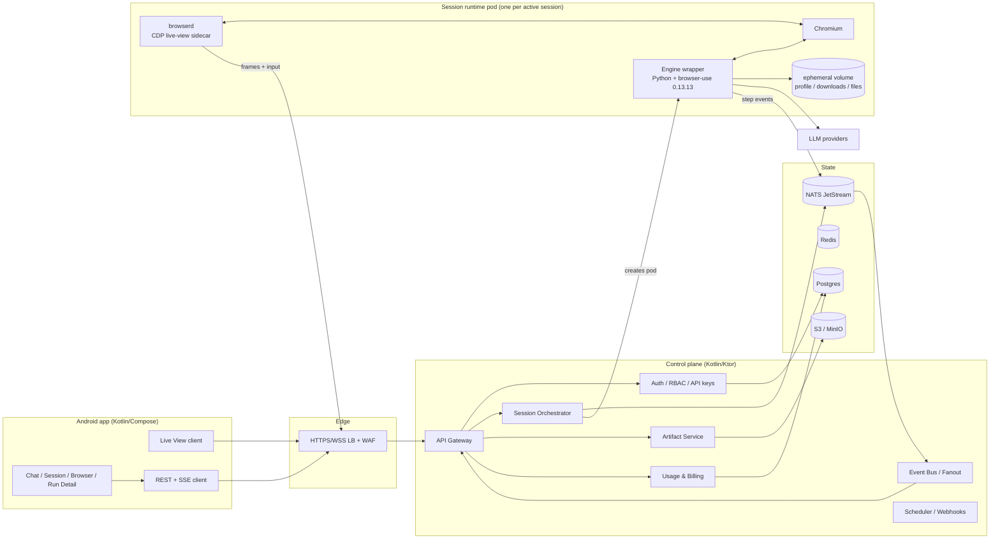
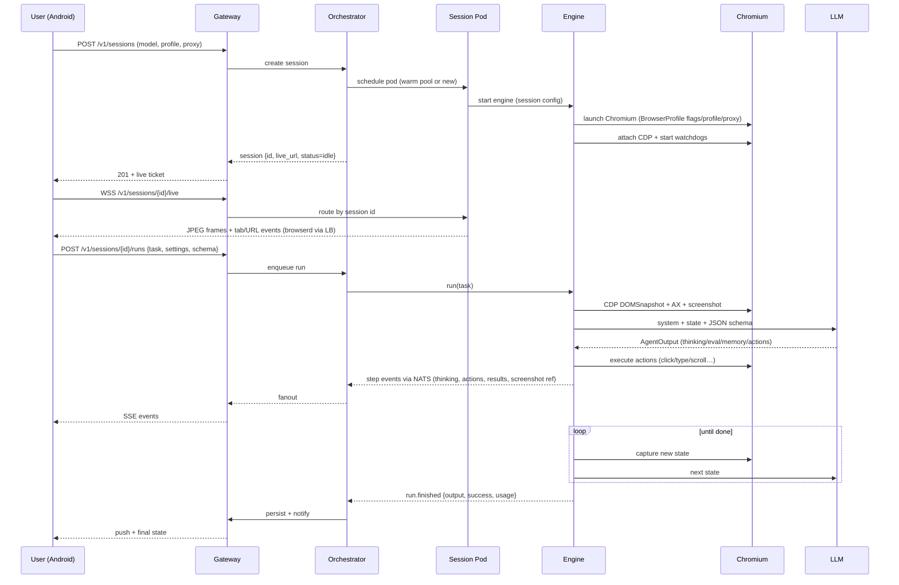
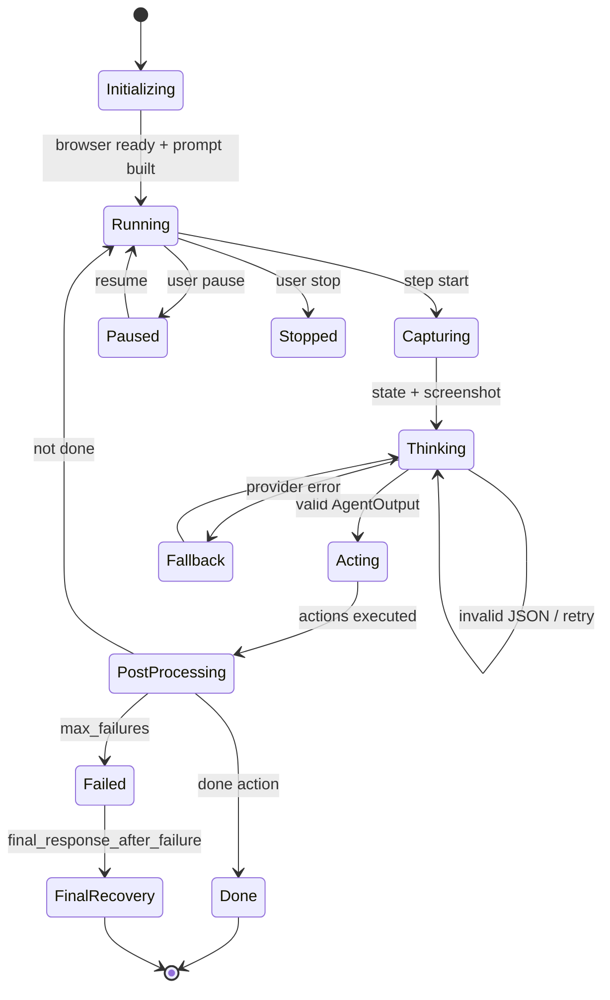
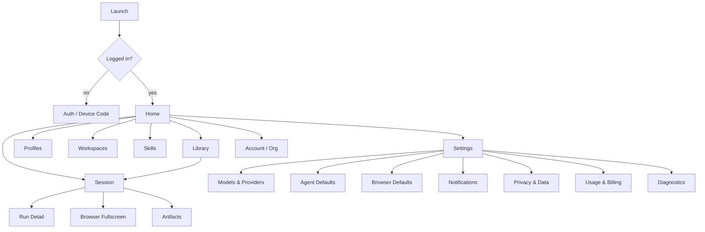

# Browser‑Use → Android: Full‑Parity Implementation Plan

**Document version:** 1.0
**Date:** 2026‑10‑26
**Source of truth:** `browser-use/browser-use` @ commit `3df5806a0d097a1546d92c49bcf1b28c9972c3bd` — package **browser-use 0.13.13**, commit date 2026‑10‑22
**Reference UI:** `browser-use/chat-ui-example` (MIT) — the official chat/session UI example, and the closest public reference for the Browser Use Cloud experience
**Target deliverable:** a Kotlin Android app that runs online, reproduces the agent's behaviour and exposes every feature of the library, with the official UI reproduced pixel‑for‑pixel and native screens for features that only exist in the CLI/library.

---

## 0. Executive summary (read this first)

### 0.1 The one hard truth

Browser‑use is **not** a browser. It is a Python agent loop that drives a **real Chromium** over the **Chrome DevTools Protocol (CDP)**, plus a DOM/AX‑tree serializer, a 24‑action tool registry, a prompt system, and 17 LLM adapters.

Android cannot host that faithfully:

| Requirement | Android reality |
|---|---|
| Full Chromium with CDP server | Android ships WebView (no CDP server, no `--remote-debugging-port` for third‑party apps). Only debuggable WebViews expose CDP through adb. |
| Chrome profiles / cookies / extensions / proxies | unavailable or heavily restricted |
| Multi‑tab, PDF viewer, downloads, HAR, video | partial at best, not Chrome‑equivalent |
| Multi‑hour runs | process can be killed at any moment; mobile networks drop |
| API keys | shipping provider keys on device is unacceptable |
| CPU/RAM | one Chromium per run is impossible |

Therefore the **only** architecture that delivers "exact functionality, nothing missing, runs online" is:

> **The run executes in the cloud, next to a real Chromium. The Android app is a real‑time, fully interactive client.**

This is also exactly how Browser Use Cloud works today (`liveUrl` + `sessions` + `messages`). We are rebuilding that product, self‑hosted, with the open‑source engine as the behavioural source of truth.

### 0.2 The plan in one paragraph

Build a Kotlin/Compose Android client, a Kotlin/Ktor control plane, and a per‑session cloud runtime (Chromium + a thin Python wrapper around **unmodified `browser-use==0.13.13`** + a live‑view sidecar). The app talks HTTPS/WSS only. The engine emits every step, thought, action, result, screenshot and artifact; the control plane persists them and streams them to the phone. The browser streams JPEG frames over WebSocket and accepts touch/keyboard input, so the user can watch *and take over* the agent's browser. Every library feature — the 24 actions, 17 LLM adapters, DOM serialization, vision, planning, compaction, judge, rerun, profiles, downloads, PDF, HAR, video, structured output, sensitive data, cloud sessions, workspaces, skills, MCP — is mapped to a screen, an API, or an explicit Tier‑3 phase. A living **parity ledger** and a differential test harness (Python engine vs. our stack, same page, same recorded LLM responses) are the guardrails that make "nothing missing" auditable.

**Why a Python engine in a "Kotlin app" project:** the Android app, the API, the orchestrator, the live‑view sidecar and all product logic are Kotlin. The Python component is an internal, pinned, replaceable *execution core* behind a versioned contract — the same way a Kotlin app can use a Postgres or an ffmpeg binary. It is the only way to ship exact parity in ~24 weeks instead of ~44–48. A pure‑Kotlin engine is a planned, drop‑in Track K (section 20), not a prerequisite.

### 0.3 At a glance

| Item | Value |
|---|---|
| Total duration to full v1 parity (Tiers 1–2) | **24 weeks** |
| Duration to Tier 3 + production hardening | **32–36 weeks** |
| Team | 6.5 FTE (2 Android, 2 backend/platform, 1 browser automation, 1 DevOps/SRE, 0.5 design, 0.5 QA automation) |
| Build cost (blended offshore) | **≈ $260k–$340k** |
| Build cost (blended US/EU) | **≈ $520k–$700k** |
| Runtime cost per 1,000 sessions/day | **≈ $1.2k–$2.4k/month** (browser pods + egress + storage; LLM billed separately) |
| App minSdk / targetSdk | 26 / 36 |
| Engine pin | `browser-use==0.13.13`, Python 3.12, Chromium stable |
| UI source | chat-ui-example (MIT) + native parity screens |

---

## 1. What was actually installed and verified (this machine)

The repository was cloned and installed into a **separate folder**, not into the plan folder:

| Item | Value |
|---|---|
| Clone | `D:\00000000-Rea\browser-use-ref` |
| Commit | `3df5806a0d097a1546d92c49bcf1b28c9972c3bd` (2026‑10‑22) |
| Package version | `browser-use 0.13.13` |
| Python | CPython 3.12.15 (uv‑managed), venv at `browser-use-ref\.venv` |
| Install command | `uv pip install --python .venv\Scripts\python.exe -e .` |
| Result | success; `import browser_use` works; registry enumerates **24 default actions** |
| Reference UI clone | `D:\00000000-Rea\chat-ui-ref` (MIT) |
| Plan output | `D:\00000000-Rea\android-browser-use\IMPLEMENTATION_PLAN.md` |

Environment caveats found and worked around (must be handled in CI/dev containers):

1. The machine's `C:` drive was full. `uv`'s default cache failed with `os error 112`. Fix used: `UV_CACHE_DIR=D:\00000000-Rea\.uv-cache`, `TEMP/TMP` on `D:`.
2. `browser-use` writes config to `~/.config/browseruse`; that path was not writable. Fix: `BROWSER_USE_CONFIG_DIR=D:\00000000-Rea\.browseruse`.
3. The CLI delegates to `browser-harness`, which writes to `~/.config/browser-harness` and needs `BH_HOME` / `BH_TMP_DIR` on a writable volume.
4. The CLI is now a **harness REPL**, not the classic task runner. Commands: `doctor`, `auth login/status/logout`, `skill`, `recordings`, `video`, `telemetry`, `mac-approve`, `--version`, `--update`, `--reload`. This matters for the "CLI parity" scope decision (section 3.3).
5. `browser-use --version` prints **0.1.13** (the `browser-harness` version), not the library version. `importlib.metadata.version('browser-use')` is **0.13.13**. Diagnostics in our product must show both (`app`, `engine`, `harness`, `chromium`) so support can identify what is actually running.

Verification evidence (runtime registry dump, abridged):

```
done | params=[text, success, files_to_display]
search | term=True | params=[query, engine]
navigate | term=True | params=[url, new_tab]
go_back | term=True | params=[description]
wait | params=[seconds]
click | params=[index]           (coordinate variant only when enabled)
input | params=[index, text, clear]
upload_file | params=[index, path]
switch | term=True | params=[tab_id]
close | params=[tab_id]
extract | params=[query, extract_links, extract_images, start_from_char, output_schema, already_collected]
search_page | params=[pattern, regex, case_sensitive, context_chars, css_scope, max_results]
find_elements | params=[selector, attributes, max_results, include_text]
scroll | params=[down, pages, index]
send_keys | params=[keys]
find_text | params=[text]
screenshot | params=[file_name]
save_as_pdf | params=[file_name, print_background, landscape, scale, paper_format, display_header_footer, header_template, footer_template]
dropdown_options | params=[index]
select_dropdown | params=[index, text]
write_file | params=[file_name, content, append, trailing_newline, leading_newline]
replace_file | params=[file_name, old_str, new_str]
read_file | params=[file_name]
evaluate | term=True | params=[code]
count 24
```

---

## 2. Ground truth: what browser-use 0.13.13 actually is

### 2.1 Repository anatomy

| Path | Lines (approx.) | Responsibility |
|---|---:|---|
| `browser_use/agent/service.py` | 4,188 | Agent lifecycle, step loop, LLM call, action execution, history, judge, rerun, planning, fallbacks |
| `browser_use/agent/views.py` | 997 | `AgentSettings`, `AgentState`, `AgentOutput`, `ActionResult`, `AgentHistory(List)`, compaction settings |
| `browser_use/agent/message_manager/*` | ~900 | Prompt assembly, history formatting, compaction, sensitive‑data filtering |
| `browser_use/agent/prompts.py` + `system_prompts/*.md` | 600 + 8 templates | System prompt variants and state message construction |
| `browser_use/browser/session.py` | 4,197 | Browser lifecycle, CDP clients, tabs, screenshots, highlights, storage state, watchdogs |
| `browser_use/browser/profile.py` | 1,300 | Every launch/behaviour option (display, proxy, extensions, video, HAR, downloads) |
| `browser_use/browser/watchdogs/*` | 14 files, ~9k | DOM, downloads, HAR, video, popups, permissions, security, storage, captcha, crash, about:blank |
| `browser_use/dom/service.py` | 1,245 | CDP snapshot + AX tree → enhanced node tree, visibility, iframes, shadow DOM |
| `browser_use/dom/serializer/*` | ~2k | Paint‑order filtering, simplification, index assignment, text serialization, eval serializer |
| `browser_use/tools/service.py` | 2,327 | `Tools` + 24 default actions + registry helpers |
| `browser_use/tools/registry/*` | ~800 | Action registration, param models, domain filters, dependency injection, execution |
| `browser_use/llm/*` | 16 provider dirs / 17 adapters | Provider adapters, message types, schema optimisation, retries |
| `browser_use/filesystem/*` | 1,104 | Sandboxed file workspace, typed files (md/txt/json/csv/jsonl/pdf/docx/html/xml/png/jpg/webp) |
| `browser_use/screenshots/*` | 70 | Screenshot persistence per step |
| `browser_use/mcp/server.py` | 1,294 | MCP server exposing 16 tools + session lifecycle |
| `browser_use/skills/*` | ~700 | Cloud "skills" fetched as deterministic actions |
| `browser_use/sync/*` | ~400 | Cloud auth/device flow, run sync |
| `browser_use/telemetry/*` | ~300 | PostHog anonymous events (opt‑out) |
| `browser_use/tokens/*` | 650 | Token counting, pricing, cost summaries |
| `browser_use/sandbox/*` | 669 | `@sandbox` remote execution decorator (SSE events) |
| `browser_use/beta/*` | 6,810 | Rust runtime integration (SDK server, sub‑agents, `browser_script`) — separate feature line |
| `browser_use/integrations/*` | ~2k | Claude browser toolset (31 actions), OpenAI computer‑use adapter |
| `examples/` | 112 files | Feature demos (the de‑facto behaviour spec) |
| `tests/` | 126 Python files (mostly `ci/`) | Real‑browser CI tests (no mocks except LLM) |

### 2.2 How the agent loop actually works (the exact mechanism)

```
Agent.run(max_steps=500)
  │
  ├─ 0. init: validate LLM, build Tools registry, create FileSystem(<tmp>/agent_files),
  │         create ScreenshotService, BrowserSession(cdp), load system prompt variant,
  │         construct AgentOutput JSON schema (custom actions + structured output),
  │         optionally detect URL in task and navigate before the first LLM call
  │
  ├─ 1. STEP
  │    ├─ capture state:
  │    │     CDP DOMSnapshot.captureSnapshot(includePaintOrder, includeDOMRects)
  │    │     Accessibility.getFullAXTree (all frames)
  │    │     Target.getTargets → tab list + 4‑char ids
  │    │     Page.captureScreenshot → PNG/JPEG
  │    │     merge into EnhancedDOMTreeNode tree
  │    │     simplify (visibility, scrollable, shadow, iframes, paint order)
  │    │     assign selector indices 1..N  → selector_map[index] = node
  │    │     serialize tree to `[index]<tag attr=... />` text
  │    │     inject highlight overlay into the page (index labels + boxes)
  │    │
  │    ├─ build ONE user message containing:
  │    │     <user_request>, <agent_history>, <agent_state> (files/todo/plan/sensitive),
  │    │     <browser_state> (URL, tabs, interactive tree, page stats, pagination),
  │    │     <read_state> (last extract/read_file output, once),
  │    │     <step_meta> (step n/max, date), optional screenshot(s) as image parts
  │    │
  │    ├─ call LLM with system + state + JSON schema (structured outputs / tool schema)
  │    │     parse AgentOutput:
  │    │       {thinking, evaluation_previous_goal, memory, next_goal,
  │    │        current_plan_item?, plan_update?, action:[{name: params}, ...]}
  │    │     repair/retry on invalid JSON; fallback LLM on 429/401/402/5xx
  │    │
  │    ├─ execute actions sequentially (max_actions_per_step, default 5):
  │    │     registry.execute_action(name, params) with injected deps
  │    │     stop sequence when page changes or action is terminating
  │    │     collect ActionResult{extracted_content, long_term_memory, error, is_done, ...}
  │    │
  │    └─ post‑process: update memory, plan, loop detector, budget warning,
  │         judge (optional), compaction (optional), screenshot storage, GIF frames
  │
  └─ 2. finish: done action or max_steps or max_failures
         → AgentHistoryList (urls, screenshots, actions, results, thoughts, usage, judge)
         → optional final recovery LLM call; optional rerun; file attachments
```

That is the whole product. Everything else is fidelity in each box.

### 2.2.1 Worked example — one real step

Task: `"Find the number of stars of the browser-use repo and save it to stars.txt"`.

State excerpt sent to the model (abridged):

```text
<user_request>
Find the number of stars of the browser-use repo and save it to stars.txt
</user_request>
<agent_history>
Step 1: Evaluation: Navigated to github.com/browser-use/browser-use. Verdict: Success
Memory: On the repo page; star count is near the top.
Next Goal: Read the star count.
Action Results: Navigated to https://github.com/browser-use/browser-use
</agent_history>
<agent_state>...files: todo.md...</agent_state>
<browser_state>
Current URL: https://github.com/browser-use/browser-use
Open Tabs: [A1B2] browser-use/browser-use
Interactive Elements:
[1]<a href="/browser-use" />
	browser-use
[7]<span aria-label="123,456 users starred this repository" />
	123k
...
</browser_state>
```

Model output (the exact schema):

```json
{"thinking":"The star count is visible at index 7. I will write it to stars.txt, verify the file, then finish.",
 "evaluation_previous_goal":"Successfully opened the repository page. Verdict: Success",
 "memory":"Star count is 123k; file not written yet.",
 "next_goal":"Write 123k to stars.txt.",
 "action":[
   {"write_file":{"file_name":"stars.txt","content":"123k"}}
 ]}
```

What the engine then does: executes `write_file` (workspace path, extension check, newline), stores the `ActionResult`, writes the step to history, and the UI renders one tool pill. The next step calls `read_file` to verify, and only then calls `done` **as a single action** with `files_to_display:["stars.txt"]` (the schema allows one action list, but `done` must not be chained — the model is instructed to finish alone). If `write_file` fails, the model sees the error in the next state and can retry — that is the entire control loop.

### 2.3 Feature surface (what must exist in the Android product)

| Area | Count / scope | Notes |
|---|---|---|
| Default actions | **24** | table in §8.1 |
| MCP tools | **16** | `browser_navigate`, `browser_click`, `browser_type`, `browser_get_state`, `browser_extract_content`, `browser_get_html`, `browser_screenshot`, `browser_scroll`, `browser_go_back`, `browser_list_tabs`, `browser_switch_tab`, `browser_close_tab`, `browser_list_sessions`, `browser_close_session`, `browser_close_all`, `retry_with_browser_use_agent` |
| LLM providers | **16 families / 17 adapters** | OpenAI, Azure OpenAI, Anthropic, Bedrock (Anthropic + generic), Google, Browser Use, Cerebras, DeepSeek, Groq, LiteLLM, Mistral, OCI raw, Ollama, OpenRouter, OrcaRouter, Vercel |
| Browser profile options | **50+** | headless, viewport, DPR, channel, args, proxy, storage state, extensions, permissions, downloads, HAR, video, traces, headers, UA, locale, timezone, security flags |
| Watchdogs | **14** | about:blank, captcha, crash, default actions, DOM, downloads, HAR, local browser, permissions, popups, recording, screenshot, security, storage state |
| System prompt variants | **8** | default, no‑thinking, flash, flash‑anthropic, anthropic‑flash, browser‑use, browser‑use‑flash, browser‑use‑no‑thinking |
| Agent settings | **40+** | §6.2 |
| Structured output | yes | Pydantic/JSON‑Schema → `done` action schema |
| Persistence | conversation JSON, history JSON, files, screenshots, GIF/MP4, HAR | |
| Cloud features | sessions, follow‑ups, live view, profiles, workspaces, webhooks, skills, marketplace, API keys, usage | |
| Security features | domain allow/deny, IP blocking, upload containment, filename sanitisation, secret redaction, sensitive‑data placeholders, `<secret>` substitution | |
| Developer surfaces | MCP server, `@sandbox`, Claude/OpenAI toolsets, CLI/harness, skills installer | |

### 2.4 The UI surfaces that exist today

Important: **the open‑source library has no GUI.** "Exact UI" therefore has a precise referent:

1. **CLI / harness** — REPL + `doctor`, `auth`, `recordings`, `video`, `telemetry`. Not an app UI; mapped to Diagnostics/Auth/Artifacts screens.
2. **`chat-ui-example` (MIT)** — the official chat UI example: home composer with 4 suggestion chips + settings bar; session view with step sections, tool pills, final markdown, and a live browser panel (55% width) with its own URL bar, tabs, back/forward/reload. This is the canonical UI to reproduce.
3. **Cloud dashboard** — sessions, profiles, workspaces, skills, usage/billing, API keys. We reproduce the product surfaces, not the marketing site.

Screenshot reference: `chat-ui-ref/public/chat-ui-session.png` (steps "Ran / Navigated / Took screenshot" on the left, live X.com browser with tab strip and URL bar on the right). The token/geometry spec in §10.2 is extracted from that codebase.

---

## 3. Product definition and scope

### 3.1 Product statement

> **"Browser Use for Android"** — an Android app where a user types a task, an AI agent drives a real cloud Chrome, and the user watches every thought/action live, can take over the browser at any moment, and receives files, screenshots, PDFs, recordings and structured results. It runs entirely online; no local browser is required.

### 3.2 Parity contract

"Exact" is defined as **observable behavioural equivalence** against a pinned reference build, measured by the harness in §14:

| Dimension | Equivalence target |
|---|---|
| DOM serialization | byte‑identical after normalising volatile values (timestamps, generated ids) |
| Element indices & bounding boxes | identical set/order; bbox ±0 px |
| Action space & JSON schema | identical names, params, types, defaults, required fields |
| Prompt text | byte‑identical templates (versioned), same section order |
| Agent decisions | ≥ 95 % same action at same step with frozen LLM cassettes; ≥ 90 % same action sequence on live models |
| Task outcome | success rate within ±3 pp of reference on the eval suite |
| Token/cost | ±5 % per task |
| UI | pixel‑level match of chat/session layout; component geometry from §10.2 |
| API | every user‑visible feature has an endpoint + screen; no dead ends |

### 3.3 Tiers (what ships when)

**Tier 1 — Core parity (must ship, weeks 1–20)**
Agent loop, prompts, 24 actions, DOM/AX pipeline, screenshots/vision, tabs, downloads, PDF, file system, structured output, sensitive data, planning, loop detection, compaction, judge, rerun, fallback, cost, profiles, proxy, allowed domains, live view + takeover, chat/session UI, run detail, artifacts, auth, session persistence, resume, push notifications.

**Tier 2 — Product parity (must ship, weeks 15–24)**
Cloud sessions & follow‑ups, queue/interrupt, profiles CRUD + profile sync (human login), workspaces + file uploads, recordings (MP4) + HAR, share links, webhooks, usage/billing, multi‑tenant orgs/RBAC, API keys, telemetry opt‑out, diagnostics, rate limits, retention policies.

**Tier 3 — Ecosystem parity (post‑v1, weeks 25–36)**
MCP server (as a service), custom tools/action SDK, skills + marketplace, Claude/OpenAI toolset adapters, screenshots→PDF export bundles, scheduled tasks, batch runs, public API, WebRTC live view, on‑prem deployment, SSO/SCIM.

**Explicitly out of scope for v1 (documented, with reason)**

| Excluded | Reason | Workaround |
|---|---|---|
| Local Chrome / `from_system_chrome` / user's own profile | phone cannot host Chrome; cloud profiles replace it | "Connect your browser" desktop companion in Tier 3 |
| Browser extensions from Chrome Web Store | container image only ships bundled extensions | allow‑list of preinstalled extensions |
| `browser_use.beta` Rust runtime, sub‑agents, `browser_script` | experimental, separate product line, 6.8k LOC | Track K phase; not part of 0.13.13 stable Agent |
| CLI harness REPL semantics | developer tool, not end‑user | Diagnostics screen + scripted API |
| 1Password SDK integration | enterprise secret manager | generic secrets vault + TOTP |
| CAPTCHA "solving" guarantees | third‑party/legal | optional provider, per‑domain policy, transparent status |
| Screen‑recording of the phone | not part of the product | cloud browser recording only |

---

## 4. Target architecture

### 4.1 Topology



### 4.2 Component responsibilities

| Component | Language | Responsibility | Scale |
|---|---|---|---|
| Android app | Kotlin, Compose | UI, streaming renderer, live browser surface, local cache, push, deep links | client |
| API Gateway | Kotlin/Ktor | REST/SSE/WSS termination, auth, quotas, request validation, idempotency | HPA |
| Session Orchestrator | Kotlin/Ktor | create/stop session pods, warm pool, sticky routing, health, timeouts | 2–20 replicas |
| Engine wrapper | Python 3.12 + FastAPI | launches and owns Chromium via `BrowserProfile` (or attaches via `cdp_url`), runs `browser_use.Agent`, maps hooks to events, exposes pause/resume/stop, follow‑ups, history, options passthrough | 1 per session pod |
| Chromium | C++ | the actual browser | 1 per pod |
| `browserd` | Kotlin/JVM (Go alternative) | CDP attach, screencast, input injection, tab/URL events, screenshot on demand, ticket auth | sidecar |
| Event bus | NATS JetStream | durable per‑run event log, resume, fanout | cluster |
| Artifact service | Kotlin | upload/download, signed URLs, retention, virus scan | HPA |
| Billing | Kotlin | token/cost ledger, browser‑minutes, plan limits | worker |
| Scheduler | Kotlin | scheduled tasks, webhooks with HMAC retries, cleanup | worker |

### 4.3 Why not put the loop in the app? (rejected designs)

| Design | Fatal flaw |
|---|---|
| Run `browser-use` in Termux / embedded Python | no Chromium+CDP, no Play Store distribution, no reliability |
| Android WebView + JS injection | different engine (no Chrome parity), no tabs/profiles/proxies/extensions/HAR/video, DOM differs, no CDP |
| Agent loop in app + remote browser over CDP | app must hold provider keys, run for hours in background (Doze kills it), handle multi‑MB DOM each step over mobile; a network blip kills the run |
| Pure Kotlin engine on server (Track K) | viable, but 20–24 extra calendar weeks (32–42 engineer‑weeks) and permanent parity drift risk; not the fastest path to "nothing missing" |

### 4.4 End‑to‑end sequence (exact)



### 4.5 Key design decisions (ADR summary)

| # | Decision | Rationale | Consequence |
|---|---|---|---|
| D1 | Server‑side execution, app as client | only way to run real Chrome reliably | requires cloud; app is useless offline (by design) |
| D2 | v1 engine = pinned upstream browser-use | exact parity, 24 weeks | Python in the stack; ops burden |
| D3 | One pod per active session | isolation, sticky state, simple cleanup | cost per session; warm pool needed |
| D4 | Screencast live view (WebRTC later) | simple, works everywhere, ~100–250 ms | JPEG bandwidth; no audio needed |
| D5 | Postgres + NATS + S3 | boring, proven, resumable | event ordering discipline |
| D6 | UI ported from chat-ui-example | official, MIT, exact | must keep attribution |
| D7 | BYOK + platform keys | enterprise + consumer | secret vault + cost ledger |
| D8 | Track K (Kotlin engine) behind same contract | de‑risk long‑term | interface must be language‑neutral |

---

## 5. Data and API contracts

### 5.1 Domain model

```
Org 1─* User 1─* ApiKey
Org 1─* Profile        (persistent browser state: cookies/localStorage)
Org 1─* Workspace 1─* WorkspaceFile
Org 1─* Session 1─* Run 1─* Step 1─* ActionExecution
Session 1─* Artifact (screenshots, files, PDFs, MP4, HAR)
Run 1─1 UsageLedger
Org 1─* Skill 1─* SkillRun
Org 1─* Webhook 1─* WebhookDelivery
Session 1─* ShareLink
```

**Critical invariants**

- A `Session` is the unit of browser state; a `Run` is one agent turn. Follow‑ups create new runs on the same session and reuse the same Chromium + agent memory.
- `Run` is append‑only: events have monotonically increasing `seq`; clients resume with `Last-Event-ID`.
- Artifacts are content‑addressed (SHA‑256) and immutable.
- Every row is org‑scoped; every query carries `org_id` (row‑level security in Postgres).

### 5.2 Database schema (Postgres 16)

| Table | Key columns |
|---|---|
| `orgs` | id, name, plan, created_at, settings jsonb |
| `users` | id, org_id, email, name, avatar, auth_provider, last_seen |
| `memberships` | org_id, user_id, role (`owner/admin/member/viewer`) |
| `api_keys` | id, org_id, name, prefix, hash (argon2), scopes, last_used, revoked_at |
| `profiles` | id, org_id, name, s3_key, size_bytes, last_synced_at, created_at |
| `workspaces` | id, org_id, name, s3_prefix, bytes_used, created_at |
| `workspace_files` | id, workspace_id, name, mime, bytes, sha256, s3_key, created_at |
| `sessions` | id, org_id, user_id, status, profile_id, proxy_country, model, chromium_version, live_ticket_hash, started_at, ended_at, idle_deadline, error |
| `runs` | id, session_id, seq_no, task, status, settings jsonb, output, success, error, started_at, ended_at, usage jsonb |
| `steps` | id, run_id, n, url, title, thinking, evaluation, memory, next_goal, plan jsonb, screenshot_artifact_id, duration_ms, tokens_in, tokens_out, cost_usd |
| `action_executions` | id, step_id, ordinal, name, params jsonb, result jsonb, error, duration_ms, page_changed |
| `artifacts` | id, org_id, session_id, kind (`screenshot/file/pdf/video/har/trace`), name, mime, bytes, sha256, s3_key, created_at |
| `events` | id, run_id, seq, type, payload jsonb, created_at (partitioned by month) |
| `usage_ledger` | id, org_id, run_id, provider, model, input_tokens, output_tokens, cached_tokens, cost_usd, browser_seconds, created_at |
| `skills` | id, org_id, title, goal, demo, params_schema jsonb, output_schema jsonb, status |
| `webhooks` | id, org_id, url, secret_hash, events[], active |
| `webhook_deliveries` | id, webhook_id, event, payload, status, attempts, next_retry_at |
| `share_links` | id, session_id, token_hash, expires_at, revoked_at |
| `audit_log` | id, org_id, actor, action, target, ip, ua, created_at |

Indexes: `(org_id, created_at desc)` on sessions/runs; `(run_id, seq)` unique on events; `(session_id, status)`; GIN on `runs.settings`; partial index on active sessions.

### 5.3 Public REST API (v1)

Base: `https://api.<domain>/v1`. Auth: `Authorization: Bearer <JWT>` or `X-Api-Key: bu_...`.

| Method | Path | Purpose |
|---|---|---|
| POST | `/auth/device` | start device‑code login |
| POST | `/auth/token` | exchange device code / refresh |
| GET | `/me` | profile + org + entitlements |
| GET | `/sessions?cursor=&status=` | list sessions (library) |
| POST | `/sessions` | create session (model, profile_id, proxy_country, recording, viewport) |
| GET | `/sessions/{id}` | status, live_url, current url/title, output, usage |
| POST | `/sessions/{id}/runs` | start a run/task; returns run id |
| GET | `/runs/{id}/events?after=` | replay events (SSE or JSON) |
| GET | `/runs/{id}` | full run incl. steps/actions |
| POST | `/sessions/{id}/messages` | follow‑up / queue (`interrupt` flag) |
| POST | `/sessions/{id}/stop` | `strategy` = `task` or `session` |
| POST | `/sessions/{id}/pause` · `/resume` | human takeover |
| POST | `/sessions/{id}/takeover` | issue short‑lived input ticket |
| GET | `/sessions/{id}/artifacts` | list artifacts |
| GET | `/artifacts/{id}/url` | signed download (60 s) |
| POST | `/sessions/{id}/files` | upload file for the agent (multipart) |
| GET/POST/PATCH/DELETE | `/profiles` | profile CRUD + sync status |
| POST | `/profiles/{id}/sync` | open browser for human login (returns live ticket) |
| GET/POST/DELETE | `/workspaces`, `/workspaces/{id}/files` | workspace CRUD + upload/list/delete |
| GET | `/skills`, GET `/skills/{id}` | list/detail |
| POST | `/skills/{id}/execute` | execute skill |
| POST | `/skills` | create from demonstration (Tier 3) |
| GET | `/usage?from=&to=` | tokens, cost, browser minutes, runs |
| GET/POST/DELETE | `/api-keys` | manage keys |
| GET/POST/PATCH/DELETE | `/webhooks` | manage webhooks |
| POST | `/webhooks/{id}/test` | test delivery |
| GET | `/health`, `/version` | diagnostics |

Errors: RFC 7807 `application/problem+json` with `type`, `title`, `status`, `detail`, `code`, `request_id`. Codes: `auth_required`, `quota_exceeded`, `session_not_found`, `session_busy`, `browser_unavailable`, `model_not_allowed`, `invalid_task`, `artifact_too_large`, `rate_limited`, `internal`.

### 5.4 Run event protocol

Transport: SSE (`text/event-stream`) with `id: <seq>`; WSS equivalent for the app's foreground stream. Persisted in `events`; replay from any `seq`.

| Event | Payload |
|---|---|
| `run.started` | run_id, session_id, model, max_steps |
| `step.started` | n, max_steps |
| `state.captured` | url, title, tabs[{id,title,url,active}], screenshot {artifact_id,w,h}, dom_stats {links,elements,iframes,shadow} |
| `model.delta` | text (thinking stream, if provider supports) |
| `model.output` | thinking, evaluation_previous_goal, memory, next_goal, current_plan_item, plan_update, actions[] |
| `action.started` | ordinal, name, params (secrets redacted) |
| `action.finished` | ordinal, name, result {extracted_content, long_term_memory, error, attachments, metadata}, page_changed, duration_ms |
| `step.finished` | n, usage {in,out,cached,cost}, duration_ms |
| `plan.updated` | items[{text,status}] |
| `judge.result` | verdict, reasoning, failure_reason, impossible_task, reached_captcha |
| `run.awaiting_user` | reason (`takeover`, `login`, `captcha`, `confirmation`) |
| `artifact.created` | artifact {id,kind,name,mime,bytes} |
| `run.finished` | output, success, steps, usage, duration, files[], error |
| `run.failed` | code, message, retryable |
| `log` | level, message |
| `heartbeat` | ts (every 15 s) |

### 5.5 Live view protocol

`WSS /v1/sessions/{id}/live?ticket=<jwt>` (ticket TTL 5 min, single session, input scope optional).

Server → client binary frames:

```
byte 0      : type   1=JPEG_FRAME 2=TAB_LIST 3=URL_CHANGED 4=CURSOR 5=CLIPBOARD 6=DOWNLOAD 7=ERROR 8=PONG
bytes 1..4  : uint32 payload length (BE)
bytes 5..8  : uint32 frame sequence
bytes 9..N  : payload
```

- JPEG frames: quality 70, max width 1280, `everyNthFrame=2`, ack-based (send `Page.screencastFrameAck` after render; drop if >2 in flight).
- `TAB_LIST`: JSON `{tabs:[{id,title,url,active}],activeId}`.
- `URL_CHANGED`: JSON `{url,title,canGoBack,canGoForward,loading}`.
- Client → server JSON: `{t:"tap",x,y}`, `{t:"down",x,y,button}`, `{t:"move",x,y}`, `{t:"up",x,y}`, `{t:"wheel",dx,dy}`, `{t:"key",key,code,mods}`, `{t:"text",text}`, `{t:"resize",w,h}`, `{t:"tab",action:"new|close|switch",id}`, `{t:"nav",action:"back|forward|reload|goto",url}`, `{t:"ping"}`.
- Backpressure: if the socket buffer exceeds 1 MB or 3 unacked frames, skip frames; never queue unbounded.
- Fallback: MJPEG over HTTPS for networks that block WSS; WebRTC in Tier 3.

### 5.6 Artifacts and files

- Screenshots: PNG per step + annotated vision image; stored under `s3://artifacts/{org}/{session}/{step}.png`.
- Files written by the agent: `FileSystem` workspace (md/txt/json/csv/jsonl/html/xml/pdf/docx/png/jpg/webp), max 10 MB each (configurable), names sanitised; path traversal rejected.
- Downloads: Chromium download dir → artifact; filename sanitised, MIME sniffed, max size enforced.
- Uploads: app → signed multipart → S3 → mounted read‑only into the pod as `available_file_paths`; `upload_file` uses `DOM.setFileInputFiles`.
- Video/HAR: per session optional; MP4 (H.264) + HAR 1.2 with `embed/attach/omit` content modes.
- Signed URLs: 60 s TTL, org‑scoped, `Content-Disposition` set; range requests supported.

---

## 6. Agent engine parity specification

### 6.1 State machine



### 6.2 Settings parity table (defaults from 0.13.13)

| Setting | Default | UI exposure |
|---|---|---|
| `max_steps` | **500** (`run()` arg) | Advanced |
| `max_actions_per_step` | 5 | Advanced |
| `max_failures` | 5 | Advanced |
| `use_vision` | `True` (`auto` accepted) | Vision mode segmented control |
| `vision_detail_level` | `auto` | Vision detail |
| `use_thinking` | `True` | Toggle |
| `flash_mode` | `False` | Toggle (overrides thinking) |
| `use_judge` / `ground_truth` | `True` / `None` | Toggle + field |
| `enable_planning` | `True` | Toggle |
| `planning_replan_on_stall` | 3 | Advanced |
| `planning_exploration_limit` | 5 | Advanced |
| `loop_detection_enabled` / `_window` | `True` / 20 | Advanced |
| `message_compaction` | enabled; every 25 steps; 40k chars floor; keep last 6; summary ≤ 6k chars | Advanced |
| `max_history_items` | `None` | Advanced |
| `max_clickable_elements_length` | 40,000 | Advanced |
| `llm_timeout` | auto (30/60/75/90 s by model) | Advanced |
| `step_timeout` | 180 s | Advanced |
| `final_response_after_failure` | `True` | Toggle |
| `directly_open_url` | `True` | Toggle |
| `calculate_cost` | `False` (we force on) | always on |
| `generate_gif` | `False` | Recording toggle |
| `include_attributes` | 30+ DOM attrs | Advanced (read‑only) |
| `sensitive_data` | `None` | Vault per session |
| `available_file_paths` | `None` | Attachments |
| `initial_actions` | `None` | API only |
| `save_conversation_path` | `None` | always persisted |
| `override/extend_system_message` | `None` | Advanced (danger) |
| `fallback_llm` | `None` | Provider chain |
| `page_extraction_llm` | same as `llm` | Extraction model |
| `llm_screenshot_size` | `None` | Advanced |
| `include_recent_events` | `False` | Debug |
| `display_files_in_done_text` | `True` | fixed |
| `task_id` / `source` | `None` | internal |

### 6.3 Prompt system (must be byte‑faithful)

Templates live in `browser_use/agent/system_prompts/`:
`system_prompt.md`, `system_prompt_no_thinking.md`, `system_prompt_flash.md`, `system_prompt_flash_anthropic.md`, `system_prompt_anthropic_flash.md`, `system_prompt_browser_use.md`, `system_prompt_browser_use_flash.md`, `system_prompt_browser_use_no_thinking.md`.

Rules:
- Selection order: browser‑use model → flash/thinking variant; Anthropic 4.5 → long cached variants; flash → flash; thinking → default; else no‑thinking.
- `override_system_message` replaces; `extend_system_message` appends with `\n`.
- State message = `SystemMessage(cache=True)` + one `UserMessage(cache=True)` per step containing:
  `<user_request>`, `<agent_history>`, `<agent_state>` (file system, todo, plan, sensitive placeholders, available files, step info), `<browser_state>` (URL, tabs, stats, interactive tree, pagination, recent events, errors), `<read_state>` (one‑shot extract/read output), `<page_specific_actions>`, `<step_meta>` at the tail (cache‑prefix friendly), optional image parts labelled "Current screenshot:".
- Message roles: system, user (state), assistant (previous AgentOutput) — the reference build keeps a single evolving state message plus history items in text; preserve that layout exactly.
- Prompt cache markers: `cache=True` on system and state; Anthropic needs ≥4096 tokens for caching (hence the 4.5 prompt variants).
- The system prompt teaches: output JSON schema, index‑only interaction, `*[` new elements, `|SCROLL|`, `|SHADOW(...)|`, popup handling, CAPTCHA is auto, multi‑action ordering (`page‑changing last`), file system discipline, plan, pre‑done verification, sensitive `<secret>` handling.

**Porting rule:** the Kotlin app never rebuilds prompts. It displays them (debug view). The engine (or Track K engine) owns them. If Track K is built, prompts are shipped as versioned resources extracted verbatim from 0.13.13 and diffed in CI.

### 6.4 History, memory, compaction

- History item text: `Step N: Evaluation / Memory / Next Goal / Action Results` (with `ActionResult` content truncated to 60k chars; read_state also 60k).
- `max_history_items`: keep first item + most recent N‑1; insert "omitted N steps" marker.
- Compaction triggers when `steps_since_last ≥ compact_every_n_steps` **and** history chars ≥ `trigger_char_count` (default 40k). Summary prompt includes previous compacted memory + history (+ read state optional), output ≤ 6k chars; state keeps `compacted_memory`, `compaction_count`, `last_compaction_step`; UI shows a "memory compacted" marker.
- Budget warning at 75 % of `max_steps`; forced `done` at last step; forced final recovery call after `max_failures`.

### 6.5 Planning, loop detection, judge

- **Planning:** model may emit `plan_update` (3–10 items) and `current_plan_item`; statuses `pending/current/done/skipped`; nudge after `planning_exploration_limit` steps without plan; replan nudge after `planning_replan_on_stall` consecutive failures; plan rendered in `<agent_state>`; UI shows chips/checklist.
- **Loop detection:** rolling 20‑action window hashed by normalised action (`click|index`, `input|index|lower(text)`, `navigate|url`, `scroll|dir|index`, `search|engine|tokens`); page fingerprint (URL hash + DOM text sample + element count); nudges at 5/8/12 repeats and 5 stagnant pages; never blocks.
- **Judge:** after `done`, optional LLM verdict via `JudgementResult{reasoning, verdict, failure_reason, impossible_task, reached_captcha}`; stored in `ActionResult.judgement` and shown as a badge in Run Detail. If `ground_truth` provided, pass it to the judge.

### 6.6 Rerun and variables (a headline feature of 0.13.13)

- Every run persists `AgentHistoryList` (model outputs, actions, results, interacted elements, screenshots, URLs).
- `rerun_history` replays actions **without calling the model**, re‑resolving element indices by:
  1. `backendNodeId` if still valid, 2. `xpath`, 3. stable hash (dynamic classes filtered), 4. accessibility name, 5. text/bounds fallback; then re‑executes with waits and menu‑reopen handling.
- `detect_variables` finds task values (dates, names, IDs) and `_substitute_variables_in_history` replaces them, enabling "run again with new inputs".
- UI: "Run again" (same inputs) and "Run with new inputs" (form generated from detected variables); shows per‑step success/error and an AI rerun summary.
- API: `POST /runs/{id}/rerun {variables?}`.

### 6.7 Structured output

- Input: JSON Schema (app) → Pydantic model in engine → `StructuredOutputAction[T]` replaces `done` params with `{success, data, files_to_display}`.
- App builder: paste schema / generate from form; validate; preview.
- Result: `history.structured_output` + raw; UI renders typed JSON tree with copy/export (JSON/CSV).
- Failure: schema validation error becomes an action error the model can fix; UI surfaces it.

### 6.8 Sensitive data and secrets

- Store per org in KMS‑encrypted vault; inject into the run as `sensitive_data` (old `{key:value}` or domain‑scoped `{pattern:{key:value}}`).
- Prompt exposes **only placeholder names**, never values; model must emit `<secret>KEY</secret>`; engine substitutes at input time and redacts from logs/events/screenshots metadata.
- TOTP: keys ending `bu_2fa_code` are treated as TOTP secrets; fresh 6‑digit codes generated on demand.
- Redaction cascade: event payloads, prompts, artifacts text, HAR headers/cookies, error messages; never persist plaintext secrets.
- UI: vault screen, per‑domain assignment, "used in this run" indicator, rotation.

### 6.9 Failure, fallback, timeouts

- Provider retry: 5 attempts, exponential backoff; on 429/401/402/500/502/503/504 switch to `fallback_llm` for the rest of the run (logged + UI badge).
- Per‑action timeout: `BROWSER_USE_ACTION_TIMEOUT_S` or 180 s; step timeout 180 s; LLM timeout per model.
- Connection‑like errors (CDP closed, browser crash) → reconnect up to 3 times, recreate tab if needed; if unrecoverable → fail run with recoverable code; session may be recreated.
- `final_response_after_failure` forces a final call with the partial history to produce a useful answer.
- Max failures → run `failed` but partial output preserved; UI offers "resume from last step" (rerun tail) in Tier 2.

### 6.10 Persistence and resume

- Engine writes `history.json`, `conversation.jsonl`, `screenshots/`, files to the session volume every step (atomic rename).
- Control plane stores normalized steps/actions/events; on pod loss the orchestrator can start a new pod, restore the Chromium profile snapshot (last 5 min), and either fail the run or continue from persisted state with `injected_agent_state` (Tier 2).
- App: `GET /runs/{id}/events?after=` fully reconstructs the UI; no client‑only state.

---

## 7. Browser & DOM parity specification

### 7.1 CDP surface used

| Domain | Calls | Purpose |
|---|---|---|
| `Target` | `setDiscoverTargets`, `getTargets`, `attachToTarget(flatten)`, `createTarget`, `closeTarget`, `activateTarget` | tabs, sessions |
| `Page` | `enable`, `navigate`, `reload`, `getNavigationHistory`, `navigateToHistoryEntry`, `captureScreenshot`, `printToPDF`, `startScreencast` | navigation, screenshots, PDF, live view |
| `Runtime` | `evaluate`, `callFunctionOn`, `addBinding` | JS actions, file inputs, scroll |
| `DOMSnapshot` | `captureSnapshot(computedStyles, includePaintOrder, includeDOMRects)` | layout + text + paint order |
| `DOM` | `getDocument`, `describeNode`, `resolveNode`, `setFileInputFiles`, `getOuterHTML` | element identity, upload, HTML |
| `Accessibility` | `getFullAXTree`, `enable` | roles/names/states |
| `Network` | `enable`, `getResponseBody`, `setExtraHTTPHeaders`, `setUserAgentOverride` | network idle, HAR, headers |
| `Emulation` | `setDeviceMetricsOverride`, `setGeolocationOverride`, `setTimezoneOverride`, `setLocaleOverride` | viewport/device |
| `Input` | `dispatchMouseEvent`, `dispatchKeyEvent`, `insertText`, `dispatchTouchEvent` | click/type/live input |
| `Browser` | `getVersion`, `grantPermissions`, `setDownloadBehavior` | health, permissions |
| `Security`/`Storage` | certificates, cookies, storage state | auth/profile |

### 7.2 Enhanced snapshot pipeline (must match reference)

1. `DOMSnapshot.captureSnapshot` with `includePaintOrder`, `includeDOMRects`, computed styles for visibility.
2. `Accessibility.getFullAXTree` for every frame (same‑origin and cross‑origin when enabled), joined by `backendNodeId`.
3. Build `EnhancedDOMTreeNode` per node: tag, attributes, bounds (absolute, iframe‑offset corrected), scroll positions, `isVisible`, `isActuallyScrollable`, `isClickable`, shadow root type, frame id, paint order, AX node, compound children (select/date/range etc.).
4. Visibility: element and all ancestors (including iframe clipping and scroll) must intersect the viewport; `display:none`, `visibility:hidden`, zero size, `aria-hidden` handling; file inputs always considered.
5. Shadow DOM: always traverse `shadowRoots`, mark host `|SHADOW(open|closed)|`; closed shadow content is not reachable, show hint.
6. Iframes: same‑origin by default; cross‑origin only if `cross_origin_iframes=True`, visible, ≥10 px per edge, depth ≤5, max 100 frames; offsets adjusted for iframe scroll.
7. Paint order: remove elements fully occluded by later‑painted elements (experimental, default on).
8. Compound components: `<select>` options (count + first 4), date/time format hints, range min/max/current.
9. Hidden interactive elements inside iframes → counted and surfaced as hints.

### 7.3 Serialization format (exact)

```
[33]<div />
	User form
	[35]<input type=text placeholder=Enter name />
	*[38]<button aria-label=Submit form />
		Submit
[40]<a />
	About us
|SCROLL| [12]<div /> (scrollTop=0, scrollHeight=2400)
|SHADOW(open)| [51]<my-widget />
```

Rules:
- Only interactive/scrollable/iframe/frame nodes get `[index]`; text nodes are raw indented lines.
- `*[` marks interactive elements new since previous step when URL unchanged.
- Attributes included (default list, 40+): `title,type,checked,id,name,role,value,placeholder,data-date-format,alt,aria-label,aria-expanded,data-state,aria-checked,aria-valuemin/max/now,aria-placeholder,pattern,min,max,minlength,maxlength,step,accept,multiple,inputmode,autocomplete,aria-autocomplete,list,data-mask,data-inputmask,data-datepicker,format,expected_format,contenteditable,…`; `class` excluded by default; values capped (e.g. 100 chars) with truncation.
- SVG: `<svg ... /> <!-- SVG content collapsed -->`.
- Image context: on interactive nodes, up to 3 child image `src/alt` contexts, ≤100 descendants.
- Compound info appended as `compound_components=(name=...,role=...,min=...,max=...,current=...,count=...,options=a|b|c|d,format=...)`.
- Page stats prepended to `<browser_state>`: links, iframes, shadow open/closed, scroll containers, images, interactive elements, total elements, text chars.
- Pagination buttons detected from `rel=next`, aria labels, text patterns; listed with index.
- Serialized length cap for clickable elements: 40k chars; overflow shows omitted hint.

### 7.4 Highlight and vision

- After indices are assigned, inject a fixed‑position overlay (`#browser-use-debug-highlights`) with a bordered box + top‑center index label per element; colour by type (clickable/scrollable/input).
- Screenshot **after** overlay injection; overlay removed before the next DOM snapshot (`remove_highlights`) so it never pollutes the tree.
- Vision message includes the annotated viewport screenshot (`detail` per setting). `use_vision="auto"` only includes it when an action requested it (e.g. `screenshot`).
- Coordinate clicking (optional): model supplies viewport coordinates; engine converts screenshot pixels → viewport (device scale) and dispatches mouse events; visual cursor highlight.

### 7.5 Markdown extraction (`extract`)

- `extract` serializes the **full page** (not just viewport) to markdown (headings, lists, tables, links, alt text), chunks it, and asks `page_extraction_llm` a query with optional JSON schema.
- Supports `start_from_char` paging for long pages; `extract_links`; `extract_images`; `already_collected` dedupe across pages; result goes only into `<read_state>` once (token control), optionally into long‑term memory.
- Truncation is explicit ("Content truncated at N chars"); UI shows full extracted text in the artifact panel.

### 7.6 Tabs, frames, scroll, page changes

- Tab id = last 4 chars of CDP target id; tab list shows active marker, title, URL.
- Focus changes from `Target.targetInfoChanged` / activation; agent's actions always target the focused tab.
- Scroll: viewport‑based pages (default 1 page ≈ viewport height, fallback 1000 px), element scroll via `index`, `scrollTop/scrollHeight` shown in state; `find_text` uses `DOM.scrollIntoViewIfNeeded` + text search, fallback JS.
- Page‑change detection: navigation events, URL change, DOM mutation counter, execution context destroyed; cancels remaining actions in the same step.

### 7.7 Files, downloads, PDF, print

- Downloads intercepted via `Browser.setDownloadBehavior` (allow, path); completion event → artifact; filename sanitised (`[A-Za-z0-9._-]`, max 120 chars); duplicate names suffixed.
- `auto_download_pdfs=True`: PDF navigations are downloaded, path surfaced in `available_file_paths`, `read_file` extracts text (PDFBox in Track K; pypdf upstream).
- `save_as_pdf`: print backgrounds, landscape, scale 0.1–2.0, Letter/Legal/A4/A3/Tabloid, header/footer templates with `date/title/url/pageNumber/totalPages` spans.
- Upload: `DOM.setFileInputFiles` on the resolved node; path must be in `available_file_paths` or the agent workspace; remote sessions allow absolute paths on the remote host (documented).

### 7.8 Profiles, storage state, proxy, stealth

- Profile = Chromium `user_data_dir` tarball in S3 (encrypted, per org/user), restored on session start, snapshotted on stop and every 5 min.
- Storage state JSON (cookies + localStorage) export/import for API users.
- Proxy: HTTP/SOCKS5 with auth; country selection via provider; per‑session sticky IP; DNS leak protection; documented latency impact.
- Stealth/anti‑bot: reference cloud uses proprietary stealth browsers. Self‑hosted parity **does not** include that. Provide: realistic UA/viewport/locale/timezone, webdriver flag removal is *not* promised, optional third‑party stealth browser via `cdp_url` (Browserbase/Steel/Bright Data). CAPTCHA: optional 2Captcha/CapSolver integration; never claim bypass; per‑domain policy + user notification.
- Extensions: preinstalled allow‑list only (uBlock Origin, ClearURLs, cookie handler) — mirrors `enable_default_extensions`.

### 7.9 Watchdogs (behavioural requirements)

| Watchdog | Behaviour we must reproduce |
|---|---|
| DOM | snapshot on demand, mutation tracking, highlight lifecycle |
| Downloads | intercept, complete, sanitise, artifact, auto‑PDF |
| HAR | record network to HAR 1.2 (full/minimal, embed/attach/omit) |
| Recording | screencast → MP4 at configured fps/size |
| Popups | auto‑dismiss `alert/confirm/prompt`, store closed messages in state |
| Permissions | grant clipboard/notifications; geolocation on request |
| Security | enforce allowed/prohibited domains on every navigation + subresource |
| Storage state | auto‑save/load, merge on start |
| Captcha | detect challenge, wait for manual/auto solve, notify model |
| Crash | detect renderer crash, reload/restore tab |
| About:blank | replace empty tab with start URL / new tab page |
| Local browser | launch/attach, profile copy, kill cleanly |
| Screenshot | per‑step capture, storage, optional GIF |
| Default actions | click/type/scroll/select semantics, page‑change stop |

---

## 8. Actions and tools parity

### 8.1 The 24 default actions (exact schema)

| # | Action | Parameters (type, default) | Semantics | Terminates sequence |
|---:|---|---|---|---|
| 1 | `done` | `text:str`, `success:bool=True`, `files_to_display:list[str]=[]` | finish, final answer, attachments; structured variant replaces params with `{success,data,files_to_display}` | — |
| 2 | `search` | `query:str`, `engine:str="duckduckgo"` | navigate to DDG/Google/Bing search URL | yes |
| 3 | `navigate` | `url:str`, `new_tab:bool=False` | go to URL, wait for load/network idle | yes |
| 4 | `go_back` | none | history back | yes |
| 5 | `wait` | `seconds:int=3` | sleep, capped 30 s, subtracts ~3 s LLM time | no |
| 6 | `click` | `index:int?`, `coordinate_x:int?`, `coordinate_y:int?` | click element by index, or coordinates when enabled; detects new tab | no (page change stops sequence) |
| 7 | `input` | `index:int`, `text:str`, `clear:bool=True` | focus, clear (or append), type; `text=""` clears only; handles autocomplete | no |
| 8 | `upload_file` | `index:int`, `path:str` | set file input files; validates available paths | no |
| 9 | `switch` | `tab_id:str` (4 chars) | focus tab | yes |
| 10 | `close` | `tab_id:str` (4 chars) | close tab (not the last one) | no |
| 11 | `extract` | `query:str`, `extract_links=False`, `extract_images=False`, `start_from_char=0`, `output_schema:dict?`, `already_collected:list[str]=[]` | full‑page markdown → LLM extraction; one‑shot read state | no |
| 12 | `search_page` | `pattern:str`, `regex=False`, `case_sensitive=False`, `context_chars=150`, `css_scope:str?`, `max_results=25` | grep page text; no LLM | no |
| 13 | `find_elements` | `selector:str`, `attributes:list[str]?`, `max_results=50`, `include_text=True` | CSS query; tag/text/attrs | no |
| 14 | `scroll` | `down:bool=True`, `pages:float=1.0` (0.5–10), `index:int?` | viewport/element scroll, multi‑page sequential | no |
| 15 | `send_keys` | `keys:str` | key combos (`Escape`, `Control+o`, `Tab Tab Enter`), literal `+` handling | no |
| 16 | `find_text` | `text:str` | scroll to text, error if absent | no |
| 17 | `screenshot` | `file_name:str?` | save file or include in next state | no |
| 18 | `save_as_pdf` | `file_name?`, `print_background=True`, `landscape=False`, `scale=1.0`, `paper_format="Letter"`, `display_header_footer=True`, `header_template?`, `footer_template?` | print to PDF artifact | no |
| 19 | `dropdown_options` | `index:int` | list native/ARIA options | no |
| 20 | `select_dropdown` | `index:int`, `text:str` | select exact option | no |
| 21 | `write_file` | `file_name:str`, `content:str`, `append=False`, `trailing_newline=True`, `leading_newline=False` | write/append; extensions md/txt/json/jsonl/csv/html/xml/pdf/docx/png/gif/jpg/jpeg/webp | no |
| 22 | `replace_file` | `file_name:str`, `old_str:str`, `new_str:str` | targeted replacement | no |
| 23 | `read_file` | `file_name:str` | read text/doc/image; images injected as vision parts | no |
| 24 | `evaluate` | `code:str` | execute JS (IIFE recommended, no Node), output capped | yes |

Registry rules: `description` (LLM‑visible), `param_model` (schema), `allowed_domains`, `terminates_sequence`, `requires_browser`, injection by parameter name (`browser_session`, `cdp_client`, `page_extraction_llm`, `file_system`, `available_file_paths`, `has_sensitive_data`), execution timeout, error → `ActionResult(error)`.

### 8.2 Custom tools (product feature)

- Server‑side action SDK (Tier 3): register `{name, description, json_schema, handler}` per org; allow‑listed domains; executed in a sandboxed worker with network egress policy; results as `ActionResult`.
- App: Tools screen listing built‑in + custom; enable/disable (maps to `exclude_actions`); per‑tool permission prompts for sensitive tools.
- Security: tool descriptions are untrusted input to the model; review UI, versioning, audit.

### 8.3 MCP server (Tier 3)

Expose the 16 tools over HTTP MCP (`/mcp`) with API‑key auth, per‑key tool allow‑list, and session mapping. Mobile app consumes MCP as a client in "Automations" (optional).

---

## 9. LLM layer

### 9.1 Provider matrix

| Provider | Adapter class | Auth | Notes |
|---|---|---|---|
| OpenAI | `ChatOpenAI` | API key / org | Responses + chat completions, structured outputs, vision |
| Azure OpenAI | `ChatAzureOpenAI` | key + endpoint | deployment names |
| Anthropic | `ChatAnthropic` | API key | cache markers, 4.5 prompt variants |
| AWS Bedrock | `ChatAnthropicBedrock`, `ChatAWSBedrock` | IAM | SigV4 |
| Google | `ChatGoogle` | API key / Vertex | Gemini schema quirks |
| Browser Use | `ChatBrowserUse` | BU API key | BU2 models; recommend if using their cloud LLM |
| Cerebras / Groq / Mistral / DeepSeek | respective | key | fast/cheap |
| OpenRouter / OrcaRouter / Vercel / LiteLLM | respective | key/base URL | gateways |
| Ollama | `ChatOllama` | local URL | self‑host |
| OCI raw | `ChatOCIRaw` | OCI config | niche |

### 9.2 Requirements

- Unified message model (system/user/assistant/tool, text + image parts), JSON schema output, streaming deltas, usage (input/output/cached/cache‑creation), provider errors normalised.
- Schema optimisation per provider (Gemini strips unsupported keywords; OpenAI strict mode; Anthropic tool‑use fallback).
- Retry/backoff + fallback chain; per‑run token/cost budget with hard stop; prompt caching; temperature defaults per provider (0 for extraction).
- BYOK: keys encrypted per org, never logged, never sent to device; optional gateway (LiteLLM) for enterprise.
- Model catalog endpoint (id, label, context, vision, price, availability) so the app never hardcodes model lists.
- Cost ledger updated per call; UI shows running $ and tokens; budget alerts.

---

## 10. Android application specification

### 10.1 UX principles

1. **It is a live agent, not a chat toy.** The browser is always one gesture away; takeover is instant.
2. **Trust through transparency.** Every thought, action, parameter and result is inspectable; secrets are never shown.
3. **One-hand first.** Composer, stop, takeover reachable by thumb; tablet/foldable get a two‑pane layout.
4. **Never lose the run.** Reconnect/resume from sequence number; push notifications when backgrounded.
5. **Exact visual language** from chat-ui-example (zinc dark, 15 sp body, 16 dp radii, minimal chrome) — not stock Material defaults.

### 10.2 Design system (extracted from chat-ui-example)

| Token | Value | Usage |
|---|---|---|
| `bg` | `#09090B` (zinc‑950) | app background |
| `surface` | `#18181B` (zinc‑900) | cards, composer, panels |
| `surfaceAlt` | `#27272A` (zinc‑800) | user bubble, pills |
| `border` | `#27272A` (zinc‑800) | 1 dp hairlines |
| `borderStrong` | `#3F3F46` (zinc‑700) | dropdown borders, focus |
| `text` | `#F4F4F5` (zinc‑100) | primary |
| `textSecondary` | `#A1A1AA` (zinc‑400) | labels |
| `textMuted` | `#71717A` (zinc‑500) | hints, URLs |
| `success` | `#22C55E` (green‑500) | step complete |
| `error` | `#EF4444` (red‑500) | stop, errors |
| `accentModel` | `#FBBF24` (amber‑400) | model chip active |
| `accentProfile` | `#4ADE80` (green‑400) | profile chip active |
| `accentWorkspace` | `#C084FC` (purple‑400) | workspace chip active |
| `accentProxy` | `#60A5FA` (blue‑400) | proxy chip active |
| Radius | 8 dp chips/buttons, 12 dp cards, 16 dp composer, 999 dp pills | |
| Type | 30/36 semibold h1, 15/24 body, 14/20 step title, 13/18 pills, 12/16 code, 11/14 URL | |
| Spacing | 4/8/12/16/24/32 dp; screen padding 16 dp; chat max width 672 dp | |
| Icons | 18 dp status circle, 16 dp toolbar, 12 dp pill glyphs, 2.5 stroke | Lucide‑equivalent vector set |
| Motion | 150 ms ease‑out; thinking dots 3×8 dp, 150 ms stagger; no parallax | |

Compose mapping: `MaterialTheme(colorScheme = darkColorScheme(background=bg, surface=surface, ...), typography = custom)`, no elevation; borders via `Modifier.border(1.dp, border)`; `RoundedCornerShape(16.dp)` composer; `WindowInsets` edge‑to‑edge; status bar transparent.

### 10.3 Information architecture



Bottom navigation (compact): **Home · Library · Settings**; session and browser are full‑screen destinations. Tablet: navigation rail.

### 10.4 Screen specifications

#### S1 — Auth / onboarding
- Logo, one‑liner, "Continue with Google / GitHub / Microsoft", "Use device code", "API key" (enterprise).
- States: loading, error, offline. Passkeys via Credential Manager. Terms/privacy links.
- On first login: 3‑step intro (task → watch → take over) with skip; choose default model (BU‑Mini equivalent / own key).

#### S2 — Home (exact chat‑ui parity)
- Centered column, max 672 dp, vertical center; h1 "What should the agent do?" (30 sp semibold, zinc‑100); subtitle "It can browse the web, interact with pages, and report back." (14 sp, zinc‑500).
- Composer (S10) with placeholder "Describe a task…"; **settings bar inside composer footer**, four 32 dp icon buttons: Model (amber, `Cpu`), Profile (green, `User`), Workspace (purple, `HardDrive`), Proxy (blue, `Globe`), each opening a 200 dp‑wide popover above the button with max height 320 dp, rows 30 dp, check on selected, "No profile/workspace/proxy" first row, proxy has search + "Popular" + "All countries" + codes.
- Four suggestion chips (exact copy): "Find the top 3 articles on Hacker News right now", "Search for flights from SF to NYC next weekend", "Go to GitHub trending and summarize the top repos", "Find a recipe for chocolate chip cookies". 13 sp, zinc‑400, bg zinc‑900, border zinc‑800, rounded full, tap → send.
- "Starting session…" (14 sp zinc‑500) while creating; error in red‑400.
- Recent sessions (3) below if any: compact rows with status dot, task snippet, relative time.

#### S3 — Session (exact layout)
- Split: chat column flex 1 (max 672 dp, 24 dp padding), browser panel 55 % width on ≥ 840 dp; phone: chat full width with a floating "Browser" pill (live thumbnail + URL) that opens S4 as a bottom sheet at 60 %, expandable to full screen.
- Chat: user bubble right (`surfaceAlt`, 16 dp radius, max 480 dp, 15 sp, pre‑wrap); assistant steps left; final answer markdown 15 sp zinc‑200 line height 1.6.
- **Step section**: header row 30 dp: 18 dp status circle (green check / red X / spacer), title 14 sp medium (e.g. "Step 1"), chevron right 16 dp rotates; expanded by default; body indented 26 dp with tool pills.
- **Tool pill**: 13 sp, bg zinc‑800, radius 6 dp, 2/3 dp padding, 18 dp circle icon (compass, cursor, arrow‑down, search, clock, camera, file+, file‑edit, file‑search, terminal, keyboard, wrench, globe), label ("Navigating/Navigated", "Clicking/Clicked", …), value in 12 sp mono zinc‑500 truncated 350 dp; tap expands a 12 sp pre block (max 200 dp high, 2000 chars) on zinc‑900/80.
- **Thinking indicator**: 3 bouncing dots + label ("Thinking…", "Starting…", step title while in progress).
- **Recording** block at end when available: border card, "Recording available", download links with icon.
- **Native additions** (not present in the reference web UI, layout‑neutral): app bar (back, title, status chip, overflow), phone browser pill/sheet, share/export, push. The chat/session surfaces themselves stay pixel‑faithful.
- Composer sticky bottom: placeholder "Send a follow‑up…", stop button (red 32 dp) while busy, send (white 32 dp) otherwise; disabled when terminal with "Session has ended".
- Auto‑scroll only if within 150 dp of bottom. Long‑press message → copy. Overflow menu: rename, share, export, stop session.
- Header: back, session title (first task truncated), status chip (Running/Idle/Done/Error), live indicator, overflow.

#### S4 — Browser (full screen)
- **Native Chrome‑like chrome**, matching the reference live view: top row 44 dp "Agent's Browser" + takeover state; second row URL bar 44 dp with back/forward/reload, editable URL (monospace 13 sp), lock icon, menu; tab strip 40 dp with favicon, title, close, "+" (horizontal scroll, active underlined).
- Viewport: aspect‑fit JPEG stream on black; pinch‑zoom with pan (does not change page zoom unless double‑tap), double‑tap to zoom 2×; tap sends click; long‑press context menu (Back/Forward/Reload/Copy URL/Open in external browser).
- Controls overlay (auto‑hide): keyboard toggle (IME input → `insertText`/key events), scroll (two‑finger), zoom buttons, screenshot, "Take over" / "Give back to agent" (pause/resume), device size label (1280×720), latency indicator.
- States: connecting, live, reconnecting (with retry), ended, error; take‑over banner "You are controlling the browser — the agent is paused".
- File chooser: agent downloads appear as a snackbar with "Open"; uploads initiated by a page show Android file picker → upload → `DOM.setFileInputFiles`.
- Security: `FLAG_SECURE` when session contains secrets (user toggle).

#### S5 — Run detail
- Header: task, status, model, duration, steps, tokens in/out, cost, judge badge.
- Timeline list, one card per step: step number, URL/title, duration; expandable sections:
  - **Thinking** (collapsible, markdown, token count)
  - **Evaluation / Memory / Next goal** (labelled rows)
  - **Plan** (chips with status)
  - **Actions** (name, params JSON pretty, result, error, page‑changed, duration)
  - **Screenshot** (thumbnail → full screen with pinch zoom; bbox overlay toggle)
  - **Artifacts** produced in the step
- Filters: All / Actions / Extracts / Errors / Files; search across text; copy step JSON; "Open URL in browser"; "Rerun from here" (Tier 2).
- Footer: final answer card, files, structured output tree, judge verdict, "Run again".

#### S6 — Library
- List of sessions with: task snippet, status chip, model, time, duration, cost, thumbnail. Search, filter by status/date, sort. Swipe to archive/delete. FAB "New task". Pull‑to‑refresh; pagination.

#### S7 — Artifacts
- Tabs: Screenshots / Files / PDFs / Recordings / HAR. Grid for images, list for files with size/type/date. Preview: image zoom, PDF via PdfRenderer, video via Media3, HAR JSON viewer. Actions: share, download (WorkManager), delete, open.

#### S8 — Profiles
- List: name, last synced, size, "Logged in?" hint, sessions count. Actions: create, rename, delete, "Sync now" → opens S4 in human‑login mode; on stop, profile saved with progress. Explainer: "Profiles keep cookies so the agent stays logged in."

#### S9 — Workspaces
- List with size/usage bar; detail: files grid/list, upload (multi), download, delete, "Use in new task". Attach workspace at session creation (settings bar) or per run.

#### S10 — Composer component (shared)
- Container: bg zinc‑900, border 1 dp zinc‑800, radius 16 dp, focus border zinc‑600; inner padding 12 dp; textarea 15 sp, min 24 dp, max 200 dp, no outline; send/stop 32 dp circle right; footer row for settings chips (home) or attach/mic (session).
- IME: `Enter` sends, `Shift+Enter` newline (hardware keyboard); on mobile, send button only.
- Attachment: paperclip → files/workspace; chips above input with remove.
- Draft persistence per session (DataStore).

#### S11 — Settings
Sections:
1. **Account** (name, email, org, sign out, delete account)
2. **Models & Providers** (default model, BYOK keys per provider, extraction model, fallback chain, test connection, model catalog with context/price/vision badges)
3. **Agent defaults** (max steps 1–1000, actions/step 1–10, max failures, vision mode/detail, thinking, flash, planning, loop detection, judge + ground truth, compaction, history items, step/LLM timeouts, final recovery, directly open URL, include attributes read‑only)
4. **Browser defaults** (viewport presets 1280×720/1440×900/1920×1080/custom, DPR, UA (Android/Chrome/Desktop presets), locale, timezone, proxy country/custom, allowed/prohibited domains, downloads auto, recording on/off, HAR on/off, extensions allow‑list read‑only)
5. **Notifications** (run finished, needs human, errors; quiet hours)
6. **Privacy & Data** (telemetry opt‑out, retention 7/30/90 days/forever, screenshot storage toggle, HAR/video defaults, export data, delete all)
7. **Usage & Billing** (browser minutes, runs, tokens, $ this cycle, invoices, plan, top‑up)
8. **Diagnostics** (versions, region, latency test, CDP/browser health, log export, "doctor" checks, feature flags)
9. **About** (licenses incl. browser-use MIT attribution, terms, privacy, support)

#### S12 — Skills (Tier 3)
- Marketplace list (title, description, params, price/est. cost), detail with parameter form, "Run", history; "Create skill" wizard (goal + demonstration task + parameters + output schema) with progress; refine feedback loop.

#### S13 — Usage & billing
- Current cycle cards (runs, browser hours, tokens, cost), chart by day, breakdown by model, invoices list, plan comparison, top‑up.

#### S14 — Diagnostics
- Health matrix: API, live view, engine, browser, LLM provider; latency p50/p95; last errors; "export logs" (redacted); environment (app version, device, region); feature flags; kill session.

### 10.5 State, streaming and resilience

- `SessionViewModel` exposes `UiState` (session, turns, steps, browserState, connection, artifacts, usage) + one‑shot `Channel<Effect>` (toast, open browser, share sheet).
- Event reducer is pure and idempotent, keyed by `run_id + seq`; out‑of‑order events buffered; gaps trigger `GET /runs/{id}/events?after=`.
- SSE reconnect with `Last-Event-ID`, exponential backoff (1→30 s), jitter; foreground service only while live view is open; otherwise FCM.
- Optimistic UI limited to composer send; server echo is authoritative (matches reference UI).
- Process death: restore from Room + last seq; no lost transcripts.
- Offline: banner, cached library/transcripts readable, actions disabled.

### 10.6 Responsive and adaptive

| Window class | Layout |
|---|---|
| Compact (<600 dp) | single pane, browser as bottom sheet/full screen, bottom nav |
| Medium (600–839 dp) | list‑detail for library; browser 50 % sheet |
| Expanded (≥840 dp) | two panes chat 45 % / browser 55 %; nav rail |
| Foldable | hinge‑aware two‑pane, browser on right |
| Landscape phone | browser full, chat overlay sheet |

### 10.7 Accessibility

- TalkBack labels for every icon; step status announced ("Step 1 completed, 3 actions").
- 48 dp minimum touch targets (pills visually 28 dp but 48 dp hit area).
- Font scaling to 200 % without clipping; no fixed‑height text containers.
- Reduced motion disables bouncing dots; high‑contrast theme; colour never sole status indicator (icon + text).
- Live view has an accessible alternative: "Describe current page" action reads URL/title and last action; keyboard navigation for browser chrome.

### 10.8 Performance budgets

| Metric | Budget |
|---|---|
| Cold start | < 1.5 s p90 (Baseline Profile) |
| Session screen open | < 300 ms from cache |
| Frame render (JPEG 1280×720) | < 16 ms, 30 fps sustained |
| Event → UI | < 150 ms p95 |
| Memory (session, 1 h) | < 300 MB, no leak (LeakCanary in CI) |
| APK size | < 25 MB (AAB, per‑ABI splits) |
| Network | < 1.5 MB/min live view (JPEG q70, 2 fps idle / 5 fps action) |

### 10.9 Security on device

- Tokens in `EncryptedSharedPreferences`/Keystore; refresh rotation; biometric gate optional.
- No provider API keys on device (BYOK keys are entered once, sent over TLS, stored server‑side; the app only sees a masked label).
- Certificate pinning (optional enterprise), no cleartext, network security config.
- Screenshots blocked (`FLAG_SECURE`) for sessions marked sensitive; clipboard copy of secrets blocked.
- Deep links validated (`app://session/{id}`), no open redirects; exported components minimal.
- Logging: no task text, URLs or tokens in release logs; crash reports scrubbed.

---

## 11. Backend / control plane

### 11.1 Services

| Service | Responsibilities | Tech |
|---|---|---|
| `gateway` | REST/SSE/WSS, authN/Z, validation, rate limits, idempotency keys, request IDs | Ktor 3, Netty |
| `orchestrator` | session lifecycle, warm pool, pod scheduling, health, timeout reaper, sticky routing | Ktor + Fabric8 K8s client |
| `eventhub` | consume engine events from NATS, validate, persist, fanout to gateway instances | Ktor + NATS |
| `artifacts` | multipart upload, signed URLs, MIME sniff, AV scan, retention | Ktor + S3 SDK |
| `billing` | usage aggregation, plan enforcement, invoices | Ktor + scheduled jobs |
| `scheduler` | scheduled runs, webhook retries, cleanup, profile snapshots | Ktor + Quartz |
| `admin` | orgs, users, quotas, feature flags, support tools | Ktor + internal SSO |

### 11.2 Session orchestration

- Warm pool: N pre‑created pods (image pulled, Chromium pre‑launched at `about:blank`) → session attach < 3 s.
- Pod spec: 2 vCPU / 4 GiB request, 4 vCPU / 6 GiB limit; ephemeral volume 2 GiB; `runtimeClass: gvisor`; read‑only root FS; no privilege; egress via proxy with allow‑list.
- Lifecycle: `created → starting → idle → running → paused → idle → stopping → stopped` + `error`.
- Timeouts: idle 5 min → stop; max session 4 h (configurable); max run 45 min; hard kill at 10 min past deadline.
- Isolation: one org per pod; no cross‑session mounts; browser profile encrypted with per‑org data key.
- Failure: pod unhealthy → orchestrator marks session `error`, keeps artifacts, offers restart; browser crash → engine reconnect; engine crash → run failed with partial history.

### 11.3 Live view fanout

- `browserd` is the only component allowed to accept viewer sockets; it validates a short‑lived ticket (JWT: session, user, scope, exp) and enforces one writer (takeover) at a time.
- Multiple viewers allowed read‑only (share links); writer token required for input.
- Frames are not persisted (except recording); they are dropped under backpressure.
- Region affinity: ticket includes region; gateway routes to the pod's regional endpoint.

### 11.4 Multi‑tenancy, quotas, billing

- Plans: Free (N runs/day, 15 min sessions), Pro (concurrency, 4 h, recordings), Team (org, RBAC, SSO, retention), Enterprise (on‑prem, custom models).
- Quotas enforced at gateway (requests/min, concurrent sessions, max steps, max upload size) and billing (tokens/$ per org/month).
- `usage_ledger` is append‑only; monthly rollup; invoices via Stripe (Tier 2).
- Abuse controls: domain deny‑list (illegal content), rate limits, CAPTCHA provider budgets, manual review queue for flagged orgs.

### 11.5 Observability

- OpenTelemetry traces: API → orchestrator → pod → engine step → LLM call; span attributes (org, session, run, step, model, tokens).
- Metrics: active sessions, pod start latency, step duration, LLM latency/error rate by provider, event lag, frame fps, drop rate, cost/run, success rate.
- Logs: structured JSON, org/session IDs, secrets redacted; 30‑day hot, 1‑year cold.
- Dashboards: SLOs (API 99.9 %, run start p95 < 6 s, event delivery p95 < 500 ms), alerting (error budget burn, provider outage, pod crash loop).
- Run tracing UI (internal) mirrors the app's Run Detail with full prompts (access‑controlled).

---

## 12. Browser infrastructure and live view

### 12.1 Image

- Base: Debian slim + Chromium stable (pinned digest) + fonts (Noto, emoji) + ffmpeg + Python 3.12 + engine deps.
- Chromium flags: `--headless=new` (no X), `--remote-debugging-port=9222`, `--remote-allow-origins=*` (localhost only), `--user-data-dir=/data/profile`, `--no-first-run`, `--disable-dev-shm-usage`, `--disable-gpu` (unless WebGL needed; use SwiftShader), `--window-size=1280,720`, `--force-device-scale-factor=1`, proxy flags, locale/timezone via env.
- Security: run as non‑root; `--no-sandbox` only inside gVisor; seccomp profile; no shell; read‑only root.
- Startup: the **engine launches Chromium** through `BrowserProfile` (so launch flags, extensions, proxy, HAR/video and downloads match upstream exactly) and publishes its `cdp_url`; `browserd` attaches as a second CDP client. The pod entrypoint only starts the engine; it never launches Chromium itself.

### 12.2 `browserd`

- Attaches to browser WS (`/json/version` → `webSocketDebuggerUrl`).
- `Target.setDiscoverTargets` → maintains tab list; on new target, attach flatten session.
- Live: `Page.enable`, `Page.startScreencast {format:jpeg, quality:70, maxWidth:1280, everyNthFrame:2}`; on frame → ack + forward; skip if backlog.
- Input: map touch/IME to `Input.dispatchMouseEvent`/`dispatchKeyEvent`/`insertText`; coordinate scaling from client viewport to page viewport.
- Navigation: `Page.navigate`, `reload`, `getNavigationHistory`, `navigateToHistoryEntry`.
- Screenshot/PDF on demand.
- Health: `/healthz` (CDP ping), `/metrics`.
- Auth: ticket verification, origin allow‑list, per‑IP rate limit, max frame size, max viewers.
- Recording: optional tap into screencast → ffmpeg (MP4) or rely on engine's recording watchdog (avoid double encode).

### 12.3 Latency targets

| Path | Target |
|---|---|
| Frame capture → phone display | < 250 ms p95 same region |
| Tap → page event | < 120 ms p95 |
| Step action → UI event | < 300 ms p95 |
| Run start (warm pod) | < 3 s |
| Cold pod start | < 12 s |

### 12.4 Regions

- Start: `ap-south-1` (Mumbai), `us-east-1`, `eu-west-1`; pod and user in same region; artifacts via CloudFront/Cloud CDN.
- Data residency: org‑level region pinning; browser pods never cross regions.

---

## 13. Security, privacy, compliance

### 13.1 Threat model (selected)

| Threat | Control |
|---|---|
| Prompt injection from page content | domain allow‑list, tool allow‑list, no secrets in prompt, confirm sensitive actions, system prompt hardening, output filtering, audit |
| SSRF via `navigate`/`evaluate` | egress proxy deny private ranges/link‑local/metadata; DNS rebinding protection; scheme allow‑list (http/https) |
| Cross‑tenant data access | org scoping everywhere, row‑level security, signed URLs bound to org, per‑org KMS keys |
| Secret leakage | vault, placeholder substitution, redaction cascade, no secrets in logs/events/screenshots |
| Malicious uploads | MIME sniff, AV scan, size limits, no execution, path containment, filename sanitisation |
| CDP exposure | Chromium binds localhost only; browserd/gateway never proxy raw CDP to clients; tickets scoped |
| Session hijack | short‑lived tickets, TLS, device binding optional, revoke on logout |
| Billing abuse | quotas, anomaly detection, CAPTCHA/provider budgets |
| Supply chain | pinned images/digests, SBOM, cosign, dependency scanning |

### 13.2 Privacy

- Page content, screenshots and files are customer data: encrypted at rest (S3 SSE‑KMS, per‑org key), in transit TLS 1.3.
- Retention: configurable 1–365 days; default 30; hard delete job; export (ZIP) and delete‑all endpoints.
- No training on customer data; LLM provider zero‑retention agreements where available; per‑org provider routing.
- Telemetry: product analytics opt‑out; raw page content never sent to analytics.
- DPA, subprocessors list, SOC 2 roadmap (Tier 3).

### 13.3 Legal / licensing

- browser-use is **MIT**: porting/deriving is permitted with copyright notice. Include `NOTICE` with "Portions derived from browser-use (MIT)" and the license text in the About screen.
- chat-ui-example is **MIT** (Copyright 2026 Browser Use): retain notice; do not use the Browser Use name/logo as your product identity. "Browser‑Use compatible" descriptive use only; trademark is separate from the code license.
- CAPTCHA solving and anti‑bot evasion can violate site terms; make it opt‑in per domain, document, and provide a "polite mode" (no stealth, respect robots/ToS where applicable).
- Play Store: declare remote browser/automation; provide content policy, abuse reporting, and account deletion.

---

## 14. Testing and parity verification

### 14.1 The parity harness (the core of "nothing missing")

```
parity/
  fixtures/            # local HTML sites: forms, shadow DOM, iframes, tables, SPA, dropdowns, uploads, PDFs
  cassettes/           # recorded LLM request/response pairs per scenario (deterministic)
  scenarios/           # YAML: task, fixture, model, settings, expected artifacts
  runner/              # runs reference (Python) and target (our stack) with the same cassette
  normalizers/         # DOM text, URLs, timestamps, ids, image hashes
  reports/             # HTML diff + metrics, published per CI run
```

For each scenario:
1. Start fixture server + reference engine on Chromium A; run with cassette; capture state snapshots, prompts, actions, results, screenshots.
2. Start target stack on Chromium B; run with same cassette; capture the same.
3. Normalize volatile fields; diff: DOM text, index maps, prompt messages, action JSON, results, screenshot perceptual hash, final output.
4. Fail on any structural diff; allow configured tolerances only for timing.
5. Publish coverage: scenarios passed / total, per subsystem.

### 14.2 Test layers

| Layer | What | Tooling | Gate |
|---|---|---|---|
| Unit | reducers, mappers, validators, cost math, URL policy | JUnit5, Kotest, MockK | 90 % on core modules |
| Contract | OpenAPI + event schemas + engine API | Schemathesis, JSON Schema, Pact | every PR |
| Engine integration | browser-use wrapper, CDP, prompts, 24 actions | pytest + pytest‑httpserver + real Chromium | every PR |
| Android UI | Compose screens, states, accessibility | Roborazzi/Paparazzi, Compose UI test | every PR |
| E2E | 30 flows on fixtures (forms, tabs, downloads, PDF, takeover, resume) | Docker compose + Maestro/Espresso | nightly |
| Agent eval | 100 tasks, 20 fixture sites, success/steps/tokens | harness + judge | nightly; block release on regression > 3 pp |
| Performance | start, frame rate, memory, event latency | Macrobenchmark, k6 | weekly |
| Security | SSRF, IDOR, secret leakage, path traversal, ticket replay | OWASP ZAP, custom suites | every release |
| Chaos | kill Chromium/engine/browserd, network split, pod eviction | Toxiproxy, chaos mesh | weekly |
| Load | 500 concurrent sessions, 50 steps each | k6 + Locust | monthly |
| Compatibility | Android 8–16, 1 GB RAM devices, tablets, foldables | Firebase Test Lab | every release |

### 14.3 Parity ledger (living document)

A CSV/table in the repo with one row per feature:

`id, subsystem, feature, upstream_ref (file:line), tier, target_module, verification (test id), status (todo|partial|done|excluded), notes`

Rules:
- No feature is "done" without a verification id that runs in CI.
- Excluded rows require a written justification + workaround (section 3.3).
- The ledger is reviewed at each phase gate; the release checklist is generated from it.
- Target: **100 % of Tier 1+2 rows `done`**; Tier 3 rows planned.

### 14.4 Definition of "exact"

- DOM text identical after normalisation on all fixtures.
- Action schema byte‑identical (names, params, defaults, required).
- Prompt templates byte‑identical (hash compared in CI against the pinned source).
- Agent trajectory ≥ 95 % action agreement with cassettes.
- UI: golden screenshots at 360×800, 412×915, 800×1280, 1280×800; layout diff threshold 0.1 %.
- Every Tier 1/2 ledger row has a passing test.

---

## 15. Delivery plan

### Phase 0 — Foundations (weeks 1–2)

- Monorepo, Gradle/version catalog, CI (lint, unit, build), branch protection.
- Design tokens + Compose theme + component library skeleton (buttons, chips, composer, step, pill, sheet).
- OpenAPI + event schemas + engine contract; generated Kotlin/Python clients.
- Dev environment: Docker compose (Postgres, Redis, NATS, MinIO, Chromium, engine), one‑command up.
- Cloud account, K8s dev cluster, image registry, secrets, OIDC.
- **Exit:** app runs empty shell; engine runs a reference task locally; contract tests green.

### Phase 1 — "It runs" (weeks 3–6)

- Session runner pod (Chromium + engine + browserd), orchestrator create/stop, warm pool.
- Engine wrapper: `run`, events, history, stop; one LLM provider (OpenAI) + BU model.
- Gateway: auth (device flow), sessions, runs, SSE; artifact upload.
- Android: auth, home, session chat, event reducer, run detail (basic), live view (view + input).
- Fixture suite #1 (forms, navigation).
- **Exit:** a real task ("find the top HN post") runs end‑to‑end on a phone; live browser + takeover works; events replay.

### Phase 2 — Core agent parity (weeks 7–10)

- All 24 actions wired and verified on fixtures; uploads/downloads/PDF.
- DOM pipeline verification: indices, shadow DOM, iframes, paint order, scroll, new‑element marking.
- Vision modes + annotated screenshots; screenshot artifacts.
- Prompt parity harness + 20 cassettes; history/memory; planning; loop detection.
- Tabs, storage state, profiles (basic), proxy.
- Run detail full (thinking/eval/memory/actions/results/screenshots), artifacts screen.
- **Exit:** parity suite ≥ 90 % scenarios pass; 24/24 actions verified; no P0 bugs.

### Phase 3 — Product UX parity (weeks 11–14)

- Chat/session UI pixel pass vs chat-ui (all breakpoints), suggestions, settings bar (model/profile/workspace/proxy), tool labels/icons, recording links, follow‑ups, stop, queue.
- Browser chrome parity: tabs, URL bar, back/forward/reload, keyboard, pinch‑zoom, takeover banner.
- Settings (agent/browser/notifications/privacy), profiles + sync, workspaces + files, library, share links, push.
- Structured output builder + viewer; sensitive data vault; judge display.
- **Exit:** UI golden tests pass; user can complete the 10 canonical journeys without a dead end.

### Phase 4 — Resilience and scale (weeks 15–18)

- Compaction UI, judge, rerun + variables, fallback LLM, retries/timeouts, cost ledger.
- Session resume after pod loss; profile snapshot/restore; crash recovery.
- HAR/video recordings; downloads history; retention jobs.
- Autoscaling, warm pool tuning, multi‑region routing, rate limits, quotas.
- Observability dashboards/SLOs; load test 200 concurrent.
- **Exit:** chaos tests pass; p95 run start < 6 s; 200 concurrent sessions stable; cost per run within target.

### Phase 5 — Security and enterprise (weeks 19–22)

- Org/RBAC, SSO (OIDC), audit log, API keys/scopes, webhooks (HMAC + retries).
- Egress proxy + SSRF controls, AV scanning, secret redaction audit, penetration test.
- Data retention/export/delete, DPA, privacy policy, in‑app disclosures.
- Usage/billing screens, plan enforcement.
- **Exit:** pen‑test criticals zero; SOC2‑readiness checklist; billing reconciliation ±1 %.

### Phase 6 — Beta and launch (weeks 23–24)

- 100‑task eval vs reference; fix regressions; performance pass; accessibility audit.
- Play Store listing, screenshots, content rating, data safety form, staged rollout.
- Docs: user guide, API docs, status page, support runbooks.
- **Exit:** parity ledger Tier 1+2 100 %; 500 concurrent sessions at p95 event < 500 ms; crash‑free ≥ 99.5 %; ANR < 0.3 %; store approval.

### Phase 7 — Tier 3 / Track K (weeks 25–36, parallel)

- MCP server, custom tools SDK, skills marketplace, scheduled/batch runs, public API.
- WebRTC live view, on‑prem Helm chart, SSO/SCIM, 1Password.
- Track K: Kotlin engine port behind the same contract (section 20), gated by parity suite.

### Milestones (demoable)

| Week | Milestone |
|---:|---|
| 2 | Shell app + local engine + contracts |
| 6 | First live task on phone with takeover |
| 10 | 24 actions + DOM parity ≥ 90 % |
| 14 | Pixel‑matched chat + browser + settings + profiles |
| 18 | Rerun/judge/resume + 200 concurrent |
| 22 | Enterprise security + billing |
| 24 | Public beta |
| 36 | Tier 3 + optional Kotlin engine |

---

## 16. Team, cost, timeline

### 16.1 Team

| Role | FTE | Focus |
|---|---:|---|
| Android lead | 1.0 | architecture, Compose, streaming, live view |
| Android engineer | 1.0 | screens, state, accessibility, tests |
| Backend/platform Kotlin | 2.0 | gateway, orchestrator, events, billing, K8s |
| Browser automation engineer | 1.0 | CDP, DOM parity, actions, engine wrapper, harness |
| DevOps/SRE | 1.0 | images, K8s, observability, security, CI/CD |
| Product designer | 0.5 | UI parity, flows, design system |
| QA automation | 0.5 | E2E, eval, release gates |
| **Total** | **6.5** | |

### 16.2 Cost (build)

Assumptions: 24 weeks, fully loaded.

| Model | Monthly blended | Total |
|---|---:|---:|
| Offshore (India/Eastern Europe) | $7k–$9k/FTE | **$260k–$340k** |
| US/EU | $14k–$19k/FTE | **$520k–$700k** |

Add 10–15 % for infra/tooling/design/legal/pen‑test.

### 16.3 Runtime cost (per 1,000 sessions/day)

Assumptions: 8 min average session, 1.5 vCPU/3 GiB average, warm pool 10 %, 3 GB egress/session, 200 MB artifacts.

| Item | Monthly |
|---|---:|
| Browser pods (~4,400 pod‑hours incl. 10 % warm pool, effective $0.16–$0.32/h) | $700–$1,400 |
| Orchestration/DB/Redis/NATS/S3 | $250–$500 |
| Egress/CDN | $150–$350 |
| Observability | $100–$200 |
| **Total (excl. LLM)** | **$1.2k–$2.4k** |

Note: 1,000 sessions/day × 8 min = 133 session‑hours/day ≈ 4,000/month; the effective $0.16–$0.32 per pod‑hour reflects 2 vCPU / 4 GiB requests, a 10 % warm pool and imperfect node bin‑packing (raw compute at $0.05–$0.08/h would be $250–$350, but dedicated session pods cannot be packed densely). LLM: $0.05–$2.00/run depending on model/steps — separate line, passed through or marked up.

### 16.4 Timeline confidence

- 80 % confidence for 24 weeks with the stated team and the Python‑engine decision.
- Add 15–20 % buffer for Play Store review, pen‑test remediation, LLM provider changes.
- Track K adds **20–24 calendar weeks** with 2 senior engineers (32–42 engineer‑weeks); do not run it concurrently with v1 unless staffed above 8 FTE.

---

## 17. Risks and mitigations

| # | Risk | Likelihood | Impact | Mitigation |
|---:|---|---|---|---|
| R1 | CDP/DOM parity drift vs upstream | high | high | pinned version; golden DOM tests; harness; no local patches without upstream test |
| R2 | Python engine ops (leaks, crashes, GIL) | medium | medium | one pod per session; memory limits; watchdog; recycle; Track K later |
| R3 | Live view latency/bandwidth on mobile | medium | high | regional pods, JPEG tuning, backpressure, WebRTC phase, WiFi hints |
| R4 | LLM cost/latency | high | high | model routing, flash mode, compaction, caching, budgets, BYOK |
| R5 | Anti‑bot/CAPTCHA walls | high | medium | transparency, optional providers, allowed domains, no guarantees |
| R6 | Play Store policy/review | medium | high | declare remote browser, abuse controls, staged rollout, fallback APK distribution |
| R7 | Security breach via prompt injection | medium | high | domain/tool allow‑lists, confirmations, egress controls, redaction, pen‑test |
| R8 | Scope creep (beta/subagents/skills) | high | high | tiers, ledger, change control |
| R9 | Android background kills | high | medium | foreground service only for live view; FCM; server‑side run persists |
| R10 | Legal/trademark | medium | medium | own brand, MIT notices, no logo use |
| R11 | Provider API changes | medium | medium | adapters isolated, contract tests, multi‑provider fallback |
| R12 | Per‑session cost at scale | medium | medium | warm pool, idle reaping, plan limits, usage pricing |

---

## 18. Definition of done (release checklist)

**Functional**
- [ ] All 24 actions execute with schema‑identical params and semantics.
- [ ] DOM serialization matches reference on 100 % fixtures (normalised).
- [ ] Screenshots include index overlays; vision modes behave (`True`/`auto`/`False`).
- [ ] Planning, loop detection, compaction, judge, rerun, fallback all observable in UI.
- [ ] Structured output validated; sensitive data placeholders + TOTP work.
- [ ] Tabs, downloads, uploads, PDF, HAR, MP4, profiles, proxy, allowed domains.
- [ ] Sessions, follow‑ups, queue/interrupt, stop task/session, resume.
- [ ] Live view: < 250 ms p95, input, takeover/give‑back, tab strip, URL bar.
- [ ] Library, run detail, artifacts, settings, profiles, workspaces, usage.
- [ ] Push notifications for done/needs‑human/error.

**Quality**
- [ ] Parity ledger Tier 1+2 = 100 % done with test IDs.
- [ ] E2E 30/30; eval success within ±3 pp; no P0/P1 bugs.
- [ ] Crash‑free ≥ 99.5 %, ANR < 0.3 %, start < 1.5 s p90.
- [ ] Accessibility: TalkBack pass, 200 % font, contrast AA.
- [ ] Security: pen‑test criticals 0, SSRF suite pass, secret scan clean.
- [ ] Load: 500 concurrent sessions, p95 event < 500 ms.
- [ ] Backups/restore drill; incident runbook; on‑call.

**Compliance**
- [ ] MIT notices for browser-use and chat-ui.
- [ ] Terms, privacy, data retention, account deletion, DPA.
- [ ] Play Store data safety + content rating.
- [ ] Export/delete data verified.

---

## 19. Repository, environments, CI/CD

### 19.1 Monorepo layout

```
browser-use-android/
├─ android/
│  ├─ app/
│  ├─ core/{designsystem,model,network,data,ui,common}/
│  ├─ feature/{auth,home,session,browser,rundetail,library,artifacts,profiles,workspaces,skills,settings,usage,diagnostics}/
│  ├─ build-logic/
│  └─ gradle/libs.versions.toml
├─ backend/
│  ├─ gateway/
│  ├─ orchestrator/
│  ├─ eventhub/
│  ├─ artifacts/
│  ├─ billing/
│  ├─ scheduler/
│  └─ shared/
├─ engine/
│  ├─ app/                 # FastAPI wrapper
│  ├─ browser_use_pin.txt  # 0.13.13
│  ├─ Dockerfile
│  └─ tests/
├─ browserd/               # live-view sidecar
├─ contracts/              # openapi.yaml, events.schema.json, engine.proto
├─ parity/                 # fixtures, cassettes, runner, reports
├─ infra/                  # terraform, helm, docker-compose
├─ docs/                   # ADRs, runbooks, user guide
└─ .github/workflows/
```

### 19.2 Environments

| Env | Purpose | Data |
|---|---|---|
| `local` | docker compose, fixtures | synthetic |
| `dev` | shared cluster, auto‑deploy main | synthetic |
| `staging` | release candidates, Play internal track | synthetic + opt‑in |
| `prod` | multi‑region | customer |

### 19.3 CI/CD

- PR: lint (ktlint/detekt, ruff), unit, contract, engine integration (Chromium container), Compose screenshots, security scan (Trivy, Semgrep), SBOM.
- Main: build images (cosign), deploy dev, run parity subset, publish test report.
- Nightly: full parity, E2E, eval, load, chaos.
- Release: version bump, changelog, staging deploy, smoke, Play internal → staged 5 % → 100 %; backend blue/green; DB migrations backward‑compatible.
- Rollback: image digest + feature flags; DB expand/contract.

---

## 20. Track K — pure‑Kotlin engine (optional, post‑v1)

If a Python runtime is unacceptable, replace the engine behind the same internal contract. Scope:

| Module | Kotlin implementation | Effort (engineer‑weeks) |
|---|---|---|
| CDP client | OkHttp WebSocket + kotlinx.serialization typed domains (Target/Page/DOM/DOMSnapshot/Accessibility/Network/Input/Emulation) | 6–8 w |
| DOM pipeline | port `EnhancedDOMTreeNode`, visibility, paint order, shadow/iframe merge, serializer | 8–10 w |
| Actions | port 24 actions + registry + injection | 4–5 w |
| Agent loop | coroutines state machine, prompts, message manager, compaction, planning, loop detection, judge | 5–6 w |
| LLM adapters | OpenAI/Anthropic/Gemini/BU first; 17 total | 4–6 w |
| Files/media | POI/PDFBox/ImageIO/Markdown | 2–3 w |
| Parity harness | reuse fixtures/cassettes; compare Kotlin vs Python outputs | 3–4 w |
| **Total** | | **32–42 engineer‑weeks** (≈20–24 calendar weeks with 2 seniors) |

Risks: subtle DOM differences, provider schema quirks, long tail of edge cases. Gate: parity suite ≥ 98 % before switching traffic; run both engines in shadow mode for 4 weeks.

---

## 21. Open decisions (defaults proposed)

| # | Decision | Proposed default | Impact if changed |
|---:|---|---|---|
| 1 | Execution core: Python pinned vs pure Kotlin | **Python pinned** | +20–24 weeks, +2 seniors |
| 2 | Branding: exact clone vs own brand | **Own brand**, UI replicated, MIT notices | legal review |
| 3 | Cloud region(s) | **Mumbai + us‑east‑1 + eu‑west‑1** | latency/cost |
| 4 | LLM billing | **BYOK + platform keys (20 % markup)** | finance/compliance |
| 5 | Auth | **Google/GitHub/Microsoft + device code** | enterprise SSO later |
| 6 | Distribution | **Play Store + direct APK** | review risk |
| 7 | CAPTCHA/stealth | **Off by default; per‑domain opt‑in** | vendor cost/legal |
| 8 | Retention default | **30 days** | storage/compliance |
| 9 | Scale target (v1) | **500 concurrent sessions** | infra sizing |
| 10 | Tier 3 skills/MCP | **After v1** | scope |

---

## Appendix A — Exact UI tokens & geometry (from chat-ui-example)

| Element | Spec |
|---|---|
| App background | `#09090B` |
| Chat max width | 672 dp, centered |
| Chat padding | 24 dp vertical/horizontal |
| Composer | radius 16 dp, 1 dp `#27272A`, bg `#18181B`, inner 12 dp, textarea 15 sp, max 200 dp |
| Send button | 32 dp circle, white, black 14 dp arrow, disabled 30 % |
| Stop button | 32 dp circle, `#DC2626`, white 12 dp square |
| User bubble | bg `#27272A`, radius 16 dp, padding 16/10 dp, 15 sp, max 480 dp |
| Step title | 14 sp medium `#E4E4E7`, 30 dp row, 18 dp status circle |
| Status | complete `#22C55E` on 20 % bg; error `#EF4444`; pending border `#3F3F46` |
| Tool pill | bg `#27272A`, radius 6 dp, 13 sp, 18 dp icon circle, value 12 sp mono `#71717A`, max 350 dp |
| Pill result | 12 sp, bg `#0C0C0F`/80, border `#27272A`, padding 12 dp, max 200 dp, 2000 chars |
| Thinking dots | 8 dp, `#A1A1AA`, 150 ms stagger |
| Browser panel | 55 % width, border‑left 1 dp `#27272A`, header 44 dp, URL bar 32 dp |
| Browser header | "Agent's Browser", 13 sp medium `#D4D4D8` |
| Suggestions | 13 sp `#A1A1AA`, bg `#18181B`, border `#27272A`, radius full, padding 12/6 dp |
| Settings icons | 32 dp, radius 8 dp, active tint per section (amber/green/purple/blue 10 % bg) |
| Dropdown | 200 dp wide, max 320 dp, bg `#18181B`, border `#3F3F46`, radius 8 dp, rows 30 dp, 12 sp |
| Home h1 | 30 sp semibold, `#F4F4F5` |
| Home subtitle | 14 sp, `#71717A` |

## Appendix B — AgentOutput JSON (reference)

```json
{
  "thinking": "The page shows a search box and a results list. I should type the query first.",
  "evaluation_previous_goal": "Successfully navigated to the site. Verdict: Success",
  "memory": "On example.com home; search box at index 4; no results yet.",
  "next_goal": "Type 'browser use' into the search field.",
  "current_plan_item": 0,
  "plan_update": ["Open site", "Search", "Extract top 3 results", "Save to file"],
  "action": [
    {"input": {"index": 4, "text": "browser use", "clear": true}},
    {"click": {"index": 7}}
  ]
}
```

## Appendix C — Engine wrapper contract (internal)

```
POST /engine/v1/sessions
  {browser: {mode: "launch"|"cdp", cdp_url?, profile_dir, downloads_dir, files_dir,
             viewport, user_agent, locale, timezone, proxy, allowed_domains, ...}}
  → {engine_session_id, chromium_version, cdp_url}

POST /engine/v1/sessions/{id}/runs
  {task, settings, output_schema?, sensitive_data_ref, available_files[], initial_actions?}
  → SSE: step/action/model/state/done events (same as public, plus prompt/state debug refs)

POST /engine/v1/sessions/{id}/messages {task, interrupt?}
POST /engine/v1/sessions/{id}/pause|resume|stop {strategy}
GET  /engine/v1/sessions/{id}/history
POST /engine/v1/sessions/{id}/actions {name, params}     # assisted/manual action
POST /engine/v1/runs/{id}/rerun {variables?}
GET  /engine/v1/health
```

Events must be exactly the public event schema (single source in `contracts/events.schema.json`) so the gateway can persist without translation.

## Appendix D — Prompt port checklist (for Track K or audits)

- [ ] All 8 templates copied verbatim; SHA‑256 pinned in CI.
- [ ] Section order: user_request, agent_history, agent_state, browser_state, read_state, page_specific_actions, step_meta.
- [ ] `*[` new element rule, `|SCROLL|`, `|SHADOW|`, SVG collapse, compound components.
- [ ] `max_actions` interpolation, action ordering rules (page‑changing last).
- [ ] Pre‑done verification block, budget warning, 75 % rule.
- [ ] Sensitive `<secret>NAME</secret>` instructions and per‑domain placeholder list.
- [ ] File system/todo.md rules; available_file_paths.
- [ ] Planning rules (`plan_update`, `current_plan_item`, replan/exploration).
- [ ] Flash/no‑thinking schema differences (fields removed, required list).
- [ ] Anthropic cache length variants (4.5).
- [ ] Prompt cache flags on system/state messages.
- [ ] History formatting and 60k truncation.
- [ ] Compaction system prompt and 6k summary cap.

## Appendix E — Source references (pinned commit)

| Topic | File |
|---|---|
| Agent loop | `browser_use/agent/service.py` |
| Settings/views | `browser_use/agent/views.py` |
| Prompts | `browser_use/agent/prompts.py`, `browser_use/agent/system_prompts/*.md` |
| Message manager | `browser_use/agent/message_manager/{service,views}.py` |
| Tools | `browser_use/tools/service.py`, `tools/views.py`, `tools/registry/*` |
| Browser | `browser_use/browser/{session,profile,events,session_manager}.py` |
| Watchdogs | `browser_use/browser/watchdogs/*` |
| DOM | `browser_use/dom/{service,views}.py`, `dom/serializer/*` |
| Files | `browser_use/filesystem/file_system.py` |
| Screenshots | `browser_use/screenshots/service.py` |
| LLM | `browser_use/llm/*` |
| MCP | `browser_use/mcp/{server,client}.py` |
| Skills | `browser_use/skills/*` |
| Cloud/sync | `browser_use/sync/*`, `skills/cloud/references/*` |
| Telemetry/cost | `browser_use/telemetry/*`, `browser_use/tokens/*` |
| Beta/Rust | `browser_use/beta/*`, `BETA_AGENT_INTEGRATION_FEATURES.md` |
| Tests | `tests/**` (126 files) |
| Examples | `examples/*` (112 files) |
| Reference UI | `chat-ui-example/src/**` |

## Appendix F — Condensed parity ledger (initial rows)

This is the seed of the living ledger described in §14.3. At plan time every row is `planned`; the repo version adds `status`, PR links and last‑run results. No row may be closed without a passing verification id.

| ID | Feature | Reference | Tier | Verification |
|---|---|---|---|---|
| A‑01 | Task input, language mirroring, `<user_request>` | `agent/prompts.py` | 1 | E2E‑01 |
| A‑02 | 8 system‑prompt variants + selection rules | `agent/system_prompts/*` | 1 | PAR‑PRM‑01 |
| A‑03 | AgentOutput JSON schema + repair/retry | `agent/views.py` | 1 | CONTRACT‑01 |
| A‑04 | Multi‑action step (5), stop on page change | `tools/service.py` | 1 | E2E‑02 |
| A‑05 | `max_steps=500`, 75 % budget warning, forced done | `agent/service.py` | 1 | E2E‑03 |
| A‑06 | `max_failures=5` + final recovery call | `agent/service.py` | 1 | E2E‑04 |
| A‑07 | `initial_actions` | `agent/service.py` | 1 | INT‑01 |
| A‑08 | `directly_open_url` | `agent/service.py` | 1 | INT‑02 |
| A‑09 | Plan (`plan_update`, `current_plan_item`) | `agent/service.py` | 1 | E2E‑05 |
| A‑10 | Replan / exploration nudges | `agent/service.py` | 2 | INT‑03 |
| A‑11 | Loop detection (5/8/12) + stagnation | `agent/views.py` | 1 | INT‑04 |
| A‑12 | Judge + ground truth | `agent/judge.py` | 1 | E2E‑06 |
| A‑13 | Rerun history without model calls | `agent/service.py` | 1 | E2E‑07 |
| A‑14 | Variable detection + substitution | `agent/variable_detector.py` | 2 | E2E‑08 |
| A‑15 | Structured output (`done` schema swap) | `agent/views.py` | 1 | E2E‑09 |
| A‑16 | Sensitive data placeholders + domain scoping | `message_manager` | 1 | SEC‑01 |
| A‑17 | TOTP `bu_2fa_code` | `tools/service.py` | 1 | SEC‑02 |
| A‑18 | Message compaction (25 steps / 40k / 6k) | `message_manager` | 1 | INT‑05 |
| A‑19 | `max_history_items` truncation | `message_manager` | 2 | INT‑06 |
| A‑20 | Conversation JSON persistence | `agent/service.py` | 1 | OPS‑01 |
| A‑21 | GIF/MP4 of run | `agent/gif.py` | 2 | OPS‑02 |
| A‑22 | Pause / resume / stop | `agent/service.py` | 1 | E2E‑10 |
| A‑23 | Fallback LLM, retries, timeouts | `agent/service.py` | 1 | RES‑01 |
| A‑24 | Token/cost accounting | `tokens/service.py` | 1 | BILL‑01 |
| A‑25 | Step hooks / callbacks | `agent/service.py` | 2 | INT‑07 |
| A‑26 | Follow‑up task (`add_new_task`) | `agent/service.py` | 1 | E2E‑11 |
| A‑27 | Demo‑mode event stream | `browser/demo_mode.py` | 3 | UI‑DBG‑01 |
| B‑01 | Launch/headless/viewport/DPR | `browser/profile.py` | 1 | BRW‑01 |
| B‑02 | Tabs, 4‑char ids, focus | `browser/session.py` | 1 | BRW‑02 |
| B‑03 | Storage state export/import | `browser/session.py` | 1 | BRW‑03 |
| B‑04 | Profiles (`user_data_dir`) + snapshot | `browser/profile.py` | 1 | BRW‑04 |
| B‑05 | Proxy auth (HTTP/SOCKS5) | `browser/profile.py` | 1 | BRW‑05 |
| B‑06 | Allowed/prohibited domains | `security_watchdog.py` | 1 | SEC‑03 |
| B‑07 | Extensions allow‑list | `browser/profile.py` | 2 | BRW‑06 |
| B‑08 | Downloads + filename sanitisation | `downloads_watchdog.py` | 1 | BRW‑07 |
| B‑09 | Auto PDF download | `downloads_watchdog.py` | 1 | BRW‑08 |
| B‑10 | Upload to file input | `tools/service.py` | 1 | SEC‑04 |
| B‑11 | HAR recording (modes/content) | `har_recording_watchdog.py` | 2 | BRW‑09 |
| B‑12 | MP4 recording | `recording_watchdog.py` | 2 | BRW‑10 |
| B‑13 | Trace files | `browser/profile.py` | 3 | BRW‑11 |
| B‑14 | Permissions/geolocation | `permissions_watchdog.py` | 2 | BRW‑12 |
| B‑15 | Cookies/clipboard | `browser/session.py` | 2 | BRW‑13 |
| B‑16 | Cross‑origin iframes | `dom/service.py` | 2 | DOM‑07 |
| B‑17 | Paint‑order filtering | `dom/serializer/paint_order.py` | 1 | DOM‑06 |
| B‑18 | Index highlight overlay | `browser/session.py` | 1 | VIS‑01 |
| B‑19 | Device emulation (UA/locale/tz) | `browser/profile.py` | 1 | BRW‑14 |
| B‑20 | 14 watchdogs | `browser/watchdogs/*` | 1 | BRW‑15 |
| B‑21 | Crash/reconnect recovery | `crash_watchdog.py` | 2 | RES‑02 |
| B‑22 | CAPTCHA wait/notify | `captcha_watchdog.py` | 3 | SEC‑05 |
| B‑23 | External/cloud browser via CDP | `browser/session.py` | 3 | BRW‑16 |
| D‑01 | DOMSnapshot + AX merge | `dom/service.py` | 1 | DOM‑01 |
| D‑02 | Visibility (ancestors, iframe clipping) | `dom/service.py` | 1 | DOM‑02 |
| D‑03 | Shadow DOM open/closed | `dom/serializer` | 1 | DOM‑03 |
| D‑04 | Iframe depth/size limits | `dom/service.py` | 1 | DOM‑04 |
| D‑05 | Compound components (select/date/range) | `dom/serializer` | 1 | DOM‑05 |
| D‑06 | Index assignment + `*[` new markers | `dom/serializer` | 1 | DOM‑06 |
| D‑07 | Text serialization format | `dom/serializer/serializer.py` | 1 | DOM‑08 |
| D‑08 | Page stats, pagination, hidden hints | `agent/prompts.py` | 1 | DOM‑09 |
| D‑09 | Markdown extraction + `start_from_char` | `dom/markdown_extractor.py` | 1 | DOM‑10 |
| D‑10 | Screenshot annotation | `browser/session.py` | 1 | VIS‑01 |
| D‑11 | Eval serializer | `dom/serializer/eval_serializer.py` | 2 | DOM‑11 |
| D‑12 | Scroll positions / DOM rects | `dom/service.py` | 1 | DOM‑12 |
| C‑01 | 24 default actions schema + semantics | `tools/service.py` | 1 | ACT‑ALL |
| C‑02 | Coordinate clicking (opt‑in) | `tools/service.py` | 2 | ACT‑02 |
| C‑03 | Upload path containment | `tools/service.py` | 1 | SEC‑04 |
| C‑04 | `evaluate` JS sandbox rules | `tools/service.py` | 1 | ACT‑04 |
| C‑05 | Custom tools registry (org SDK) | `tools/registry` | 3 | TOOL‑01 |
| C‑06 | Exclude actions | `tools/service.py` | 1 | ACT‑06 |
| C‑07 | MCP server (16 tools) | `mcp/server.py` | 3 | MCP‑01 |
| C‑08 | Claude/OpenAI toolset adapters | `integrations/*` | 3 | INTG‑01 |
| U‑01 | Home layout, composer, suggestions | `chat-ui-example` | 1 | UI‑01 |
| U‑02 | Settings bar (model/profile/workspace/proxy) | `chat-ui-example` | 1 | UI‑02 |
| U‑03 | Step sections + tool pills | `chat-ui-example` | 1 | UI‑03 |
| U‑04 | Browser chrome (tabs/URL/nav) | live view | 1 | UI‑04 |
| U‑05 | Takeover/give‑back | cloud live view | 1 | UI‑05 |
| U‑06 | Run detail timeline | library data | 1 | UI‑06 |
| U‑07 | Library | dashboard | 1 | UI‑07 |
| U‑08 | Artifacts | dashboard | 1 | UI‑08 |
| U‑09 | Settings (agent/browser/privacy) | library params | 1 | UI‑09 |
| U‑10 | Profiles | cloud profiles | 1 | UI‑10 |
| U‑11 | Workspaces | cloud workspaces | 2 | UI‑11 |
| U‑12 | Skills | cloud skills | 3 | UI‑12 |
| U‑13 | Usage/billing | dashboard | 2 | UI‑13 |
| U‑14 | Diagnostics | CLI doctor | 2 | UI‑14 |
| U‑15 | Accessibility | — | 1 | A11Y‑01 |
| U‑16 | Responsive/tablet/foldable | — | 1 | UI‑15 |
| U‑17 | Push + deep links | — | 2 | UI‑16 |
| S‑01 | Sessions/runs/events | cloud API | 1 | API‑01 |
| S‑02 | Follow‑ups / queue / interrupt | cloud API | 1 | API‑02 |
| S‑03 | Stop task vs session | cloud API | 1 | API‑03 |
| S‑04 | Live tickets | cloud live view | 1 | API‑04 |
| S‑05 | Artifacts + signed URLs | cloud files | 1 | API‑05 |
| S‑06 | Profile sync + human login | cloud profiles | 2 | API‑06 |
| S‑07 | Workspaces + files | cloud workspaces | 2 | API‑07 |
| S‑08 | Share links | cloud shares | 2 | API‑08 |
| S‑09 | Webhooks + HMAC | cloud webhooks | 2 | API‑09 |
| S‑10 | API keys + scopes | cloud keys | 2 | API‑10 |
| S‑11 | Orgs/RBAC/SSO | — | 2 | API‑11 |
| S‑12 | Usage/billing | cloud | 2 | BILL‑02 |
| S‑13 | Retention/export/delete | — | 2 | PRIV‑01 |
| S‑14 | Telemetry opt‑out | `telemetry/*` | 2 | PRIV‑02 |
| X‑01 | SSRF/egress controls | `security_watchdog.py` | 1 | SEC‑06 |
| X‑02 | Secret redaction cascade | `message_manager` | 1 | SEC‑01 |
| X‑03 | Upload containment | `tools/service.py` | 1 | SEC‑04 |
| X‑04 | Domain filter bypass tests | `tests/security` | 1 | SEC‑03 |
| X‑05 | Cross‑tenant isolation | — | 1 | SEC‑07 |
| X‑06 | Ticket replay/scope | — | 1 | SEC‑08 |
| X‑07 | Prompt‑injection controls | — | 2 | SEC‑09 |
| X‑08 | Audit log | — | 2 | SEC‑10 |
| O‑01 | Pod lifecycle + warm pool | — | 1 | OPS‑03 |
| O‑02 | Resume after pod loss | — | 2 | RES‑03 |
| O‑03 | Multi‑region routing | — | 2 | OPS‑04 |
| O‑04 | Observability/SLOs | — | 1 | OPS‑05 |
| O‑05 | CI/CD + rollback | — | 1 | OPS‑06 |
| O‑06 | Backup/restore | — | 2 | OPS‑07 |
| O‑07 | Load + chaos | — | 1 | OPS‑08 |
| O‑08 | Store release + data safety | — | 1 | OPS‑09 |

**Coverage summary:** 27 agent rows, 23 browser rows, 12 DOM rows, 8 action rows (covering all 24 actions), 17 UI rows, 14 API/cloud rows, 8 security rows, 8 ops rows — **117 tracked items** for v1+Tier 3. Tier 1+2 rows are the release gate.
